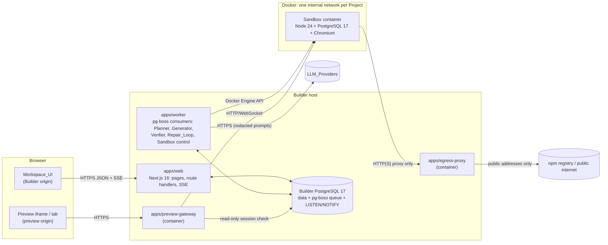
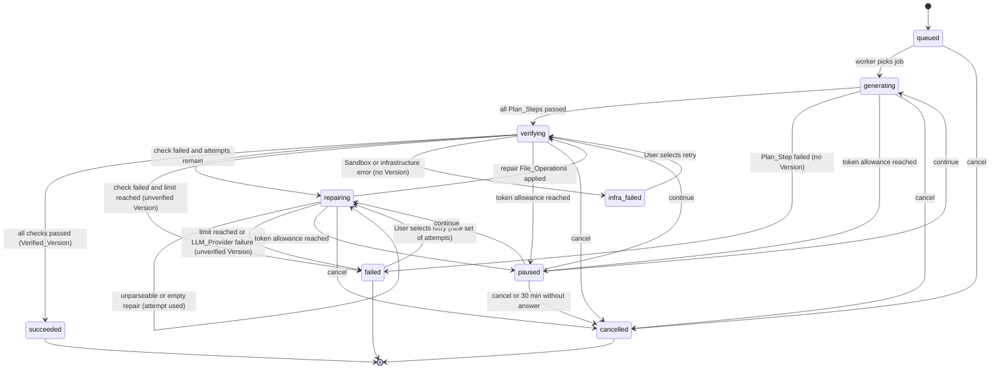
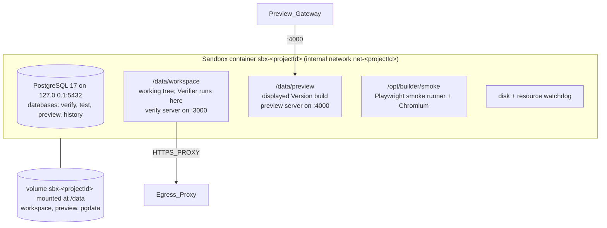
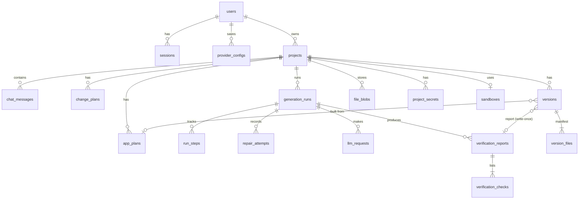

# Design Document: AI App Builder

## Overview

The AI App Builder (the Builder) turns a chat Prompt into a verified full-stack application. This document fixes everything the requirements leave to design: the Target_Stack, the App_Plan schema and its text form, the File_Operation format, the Verification_Pipeline commands, the Sandbox technology, and the directories that the Exporter skips. It also defines the component contracts needed to derive an MVP task list. Later Phase features (GitHub push, deployment) appear as interfaces only.

### How the design delivers precision

The requirements name precision as the main difference from existing tools. The design gets there with five mechanisms:

1. **Plan first, validated.** The Planner's output must pass a strict schema and a set of semantic rules (references, duplicate identifiers, Plan_Step order, color contrast, Target_Stack lint) before the User can approve it.
2. **Compile what can be compiled.** Deterministic Builder code, not the LLM, produces the database schema, SQL migrations, design tokens, API contracts, invalid-request tests, README, `.env.example`, and the auth module from the App_Plan. The LLM writes route handlers, pages, components, seed data, and valid-request tests.
3. **The template owns cross-cutting behavior.** Validation error bodies, the 500 handler, the health endpoint, loading/empty/error states, page transitions, and reduced-motion handling live in Builder-owned template files that the LLM cannot edit.
4. **Every LLM edit passes policies.** File_Operations go through path safety, protected-file, dependency allowlist, path portability, chat-edit scope, and secret scrubbing checks before they touch the Generated_Project.
5. **A Version is "working" only after it ran.** Every Version goes through the 9-check Verification_Pipeline in a Sandbox, with an automatic Repair_Loop on failure.

### Key decisions

| Area | Decision | Main alternative considered | Rationale |
|---|---|---|---|
| Runtime | Node.js 24 LTS everywhere (Builder and Sandbox image), TypeScript 5.x, npm workspaces | Node.js 26, which enters LTS on 2026-10-28 | Node 24 is the mature Active LTS line (24.22.0 at the time of writing). Moving to 26 later is a version bump in one Dockerfile and `.nvmrc`. |
| Builder web app | Next.js 16 (App Router) + React 19 + Tailwind CSS v4 + shadcn/ui + Motion, Monaco for code | Vite SPA + separate Fastify API | One framework for pages, route handlers, server-side session checks, and SSE. Matches the suggested stack and the shadcn ecosystem. |
| Long-running work | Separate `worker` process consuming pg-boss 12 jobs | BullMQ + Redis; running inside Next.js request handlers | Generation_Runs last minutes and must survive HTTP disconnects. pg-boss uses PostgreSQL `SKIP LOCKED`, so the MVP needs no Redis. |
| Builder data | PostgreSQL 17 + Drizzle ORM; drizzle-kit for the Builder's own migrations | Prisma | Typed SQL, small runtime, migrations reviewed by developers (interactive prompts are fine there). |
| LLM access | Vercel AI SDK 6 with `@ai-sdk/openai`, `@ai-sdk/anthropic`, `@ai-sdk/google`, `@ai-sdk/openai-compatible`; SDK retries disabled (`maxRetries: 0`) | Hand-written fetch adapters per provider | Uniform streaming, abort signals, and token usage across providers. The SDK retries twice by default, so the design turns that off and applies its own policy from Requirement 3.5. |
| Builder auth | Own small module (session pattern from the Lucia / Copenhagen Book guides), Argon2id via `@node-rs/argon2` | Better Auth | Requirement 1 needs a per-email lockout that also covers unregistered addresses and an exact 7-day sliding expiry. The module is small and fully property-testable. |
| Sandbox | Docker containers via `dockerode`, behind a `SandboxProvider` interface; E2B as a drop-in alternative | E2B cloud sandboxes for the MVP | See the comparison below. Docker is free, works offline on Windows through Docker Desktop, and gives full network control. |
| Generated-app migrations | Builder-owned SQL migration compiler plus a short migration runner | `drizzle-kit generate` | drizzle-kit resolves renames by prompting the user interactively, which blocks unattended runs. App_Plan items carry stable ids, so the compiler knows renames exactly. |
| App_Plan text | Canonical JSON, parsed with `jsonc-parser` in strict mode (line/column errors) and validated with Zod 4 | YAML | LLMs emit JSON reliably, providers offer JSON modes, and strict JSON has one canonical printed form. |
| File_Operation format | Line-based `<file-op>` tags with tilde fences whose length the printer chooses | bolt.diy `<boltAction>` and dyad `<dyad-write>` tags with raw content | Raw-content tags break when the content contains the closing tag. Variable-length fences give exact round trips. |
| Preview | Production build served by the generated server, behind a Preview_Gateway on a separate origin | Vite dev server with HMR | The User sees exactly the build that passed verification. A separate origin keeps generated JavaScript away from Builder cookies. |
| Tests | Vitest + fast-check, PGlite for migration properties, Playwright (+ axe-core) for end-to-end and smoke tests | Jest | Fast, ESM-native, and the same runner in the Builder and the generated apps. |

### Sandbox comparison: Docker vs E2B

| Criterion | Docker containers (local) | E2B cloud sandboxes |
|---|---|---|
| Cost | Free | Billed per second of vCPU and RAM while running; new accounts get $100 of credits ([E2B billing](https://docs.e2b.dev/billing)) |
| Windows developer machine | Docker Desktop with the WSL 2 backend; no internet needed after the image is built | Needs internet and an E2B API key |
| Isolation strength | Shared kernel (namespaces + cgroups). gVisor (`runsc`) can harden Linux hosts | Firecracker microVM per sandbox |
| Egress control | Builder must build it: internal Docker network + Egress_Proxy | Built in: private and link-local ranges are always blocked, plus `allowOut`/`denyOut` rules ([E2B public access docs](https://docs.e2b.dev/network/restrict-public-access)) |
| Owner-only preview | Builder's Preview_Gateway | `allowPublicTraffic: false` plus an `e2b-traffic-access-token` header. Browsers cannot add that header to an iframe, so a gateway is still needed |
| CPU / memory / process limits | `NanoCpus`, `Memory`, `PidsLimit` on the container | Set per template |
| Disk limit | `--storage-opt size` works only on overlay2 over XFS with `pquota` ([moby#46823](https://github.com/moby/moby/issues/46823)), which Docker Desktop does not provide, so a disk watchdog is required | Template disk size |

**Decision:** Docker for the MVP. The User is learning on a Windows machine, wants zero running cost, and the MVP is single-tenant. The `SandboxProvider` interface keeps E2B one adapter away for a hosted, multi-tenant deployment, where microVM isolation matters more.

### Research notes

- **Reference projects.** bolt.diy (MIT) streams `<boltArtifact>`/`<boltAction>` XML from the model and supports many providers; the design borrows the idea of tagged file actions in model output. dyad (mixed license) uses `<dyad-write path="…">` tags; no dyad code is reused, so its license does not affect the Builder. OpenHands (MIT) informs the event-stream and sandbox-runtime split. e2b-dev/fragments (Apache-2.0) informs the E2B adapter. The design copies no code from any of them.
- **AI SDK 6.** `streamText` accepts `abortSignal`, defaults to `maxRetries: 2`, and has a separate `streamRetries` option; both are set to 0. Usage arrives as `totalUsage.inputTokens` / `outputTokens`, each `number | undefined`. Undefined values drive the "incomplete" token label in Requirement 22.4 ([AI SDK streamText reference](https://ai-sdk.dev/docs/reference/ai-sdk-core/stream-text)).
- **Motion.** `<MotionConfig reducedMotion="user">` turns off transform and layout animations when the OS asks for reduced motion and keeps opacity animations ([Motion accessibility docs](https://motion.dev/docs/react-accessibility)). The template and the Workspace_UI also cap durations at 150 ms in that mode.
- **drizzle-kit.** Its generator asks the user to resolve rename ambiguity ([drizzle-kit README](https://github.com/drizzle-team/drizzle-orm/blob/main/drizzle-kit/README.md)). That is why generated apps use the Builder's migration compiler.
- **Tailwind CSS v4.** `@theme` variables map design tokens directly to utility classes in CSS ([Tailwind theme variables](https://tailwindcss.com/docs/configuration/)). The single token source location (Requirement 10.1) is one compiled CSS file.
- **react-resizable-panels v4** accepts sizes with CSS units such as `"320px"` ([issue #687](https://github.com/bvaughn/react-resizable-panels/issues/687) discusses the unit API). If pixel minimums prove unreliable, the Workspace_UI converts 320 px to a percentage on each resize.
- **Versions.** Next.js 16.x ([Next.js 16](https://nextjs.org/blog/next-16)), pg-boss 12.x ([pg-boss](https://github.com/timgit/pg-boss)), Node.js 24 LTS ([Node.js releases](https://nodejs.org/en/about/previous-releases/)).

Content from these sources was rephrased for compliance with licensing restrictions.

### Licensing finding that affects Requirement 24

The initial Approved_License_List (MIT, Apache-2.0, BSD-2-Clause, BSD-3-Clause, ISC) will fail the build on the first run. Common transitive dependencies of this stack use other licenses: `caniuse-lite` (CC-BY-4.0, via browserslist), `lightningcss` (MPL-2.0, via Tailwind CSS v4), `argparse` (Python-2.0, via ESLint and js-yaml), several isaacs packages (BlueOak-1.0.0), `tslib` variants (0BSD), and the optional `@img/sharp-libvips-*` binaries used by Next.js image optimization (LGPL-3.0-or-later). The license check in this design reports them precisely. The Builder owner then either adds licenses to the Approved_License_List after review or removes the dependency (for example, disabling Next.js image optimization removes `sharp`). Requirement 24.2 only fixes the initial contents, so this needs no requirement change, but the first implementation task must expect it.

## Architecture

### System context



Main flows:

- **Request path.** The browser talks only to `apps/web`. Mutating requests (save Prompt, approve App_Plan, cancel) write rows and enqueue pg-boss jobs in one transaction.
- **Work path.** `apps/worker` picks up jobs, calls LLM_Providers, applies File_Operations, and drives the Sandbox through the Docker Engine API (named pipe `//./pipe/docker_engine` on Windows, `/var/run/docker.sock` on Linux).
- **Event path.** The worker inserts `run_events` rows and sends `NOTIFY project_<id>`. The SSE route handler in `apps/web` listens and forwards events to the browser. Streamed LLM chunks are batched every 50 ms, which keeps the 100 ms display target of Requirement 21.4.
- **Preview path.** The preview iframe loads from `https://p-<projectId>.<PREVIEW_DOMAIN>`. The Preview_Gateway checks the preview cookie and the owner's session, then proxies to the Sandbox's preview server.

### Local deployment on the Windows developer machine

| Process | How it runs | Notes |
|---|---|---|
| `builder-db` | Docker Compose service `postgres:17` | Data volume `builder-db-data`. |
| `egress-proxy` | Docker Compose service, joined to the default compose network and to each Sandbox network | Forward HTTP/HTTPS proxy that refuses private destinations. |
| `preview-gateway` | Docker Compose service, port `8443` published to the host | Joined to each Sandbox network by the worker (`network.connect`). |
| `apps/web` | `npm run dev -w apps/web` on the host (`next dev --experimental-https`) | HTTPS locally so Secure cookies and Requirement 23.5 behave as in production. |
| `apps/worker` | `npm run dev -w apps/worker` on the host | Needs Docker Desktop running. |
| Sandbox image | `docker build -f docker/sandbox.Dockerfile -t builder-sandbox:1 .` | Built once; contains a warm npm cache of every allowlisted package. |

Local preview origins use `*.preview.localhost`, which browsers resolve to loopback and treat as origins separate from `localhost`. Production uses a separate registrable domain for previews and terminates TLS in a reverse proxy (Caddy) that redirects HTTP to HTTPS.

The repository uses `.gitattributes` with `* text=auto eol=lf` and code always uses `path.posix` for Generated_Project paths, so Windows path separators never leak into File_Operations or archives.

### Monorepo layout (Builder)

```
lovaAble/
  package.json                 # npm workspaces, root scripts: build (runs license:check first), test, lint
  apps/
    web/                       # Next.js 16: Workspace_UI, REST route handlers, SSE
    worker/                    # pg-boss consumers: planning, generation, verification, sandbox lifecycle
    preview-gateway/           # Node HTTP/WebSocket reverse proxy (container image)
    egress-proxy/              # Node forward proxy with address filter (container image)
  packages/
    core/                      # Pure, isomorphic domain logic (no Node or DOM APIs). Most properties test this.
    db/                        # Drizzle schema, Builder migrations, repositories
    llm/                       # Provider_Registry adapters, retry policy, usage accounting
    sandbox/                   # SandboxProvider interface, DockerSandbox, E2BSandbox (stub in MVP)
    verifier/                  # Verification_Pipeline definition and runner
    template/                  # Generated-app template files, dependency allowlist, Stack_Guide prompt text
    compilers/                 # Schema, migration, token, contract, env, README, auth compilers
    smoke/                     # Playwright smoke runner baked into the Sandbox image
    ui/                        # Workspace_UI components shared by apps/web (shadcn-based)
  docker/
    compose.yaml
    sandbox.Dockerfile
  licenses/
    approved-licenses.json     # Approved_License_List
    copied-code.json           # Entries for code copied or adapted from reference projects
    overrides.json             # Manually verified licenses for packages with missing metadata
  scripts/
    check-licenses.ts
    generate-notices.ts
  THIRD_PARTY_NOTICES.md
```

`packages/core` holds the Plan_Parser, Plan_Printer, Edit_Parser, Edit_Printer, `applyOperations`, path policy, validators, plan diff, Change_Plan logic, lockout reducer, retry policy, token budget, Redactor, Secret_Scrubber, Secret_File classifier, and license logic. It runs in the browser too, which gives instant App_Plan validation in the editor (Requirement 6.2, 1 second).

### Generation flow (plan, approve, generate, verify, repair)

```mermaid
sequenceDiagram
  autonumber
  actor U as User
  participant W as apps/web
  participant Q as pg-boss (DB)
  participant K as worker
  participant L as LLM_Provider
  participant S as Sandbox

  U->>W: Submit Prompt
  W->>W: Validate length, persist to chat history
  W->>Q: enqueue plan.create
  Q->>K: plan.create
  K->>L: Analyze Prompt (clarification needed?)
  alt Unclear pages, entities, or auth
    K-->>U: 1-5 clarifying questions + skip control (via SSE)
    U->>W: Answers or Skip
    W->>Q: enqueue plan.create (with answers / skip)
  end
  K->>L: Generate App_Plan JSON (streamed)
  K->>K: Plan_Parser; up to 2 correction requests
  K-->>U: App_Plan draft (sections, assumptions)
  U->>W: Edit / revise via chat / Approve
  W->>W: Plan_Parser (0 errors) then save approved App_Plan
  W->>Q: enqueue run.start (one Generation_Run)
  Q->>K: run.start
  loop Each Plan_Step in order
    alt Builder layer (setup, database, contracts, design, auth)
      K->>K: Deterministic compiler emits File_Operations
    else LLM layer (backend, seed, frontend, tests)
      K->>L: Step request (plan, step, file paths, step file contents)
      K->>K: Edit_Parser, policies, Secret_Scrubber; up to 2 corrections
    end
    K->>K: applyOperations on working tree (atomic)
  end
  K->>S: Sync working tree
  loop Verification_Pipeline, then Repair_Loop while attempts remain
    K->>S: install, typecheck, lint, build, migrate, start, health, smoke, tests
    alt Any check fails
      K->>L: Fix request (check, last 200 log lines, up to 20 files)
      K->>K: Parse + apply repair File_Operations
    end
  end
  K->>K: Save Version (verified or unverified) + report
  K->>S: Promote verified build to preview slot
  K-->>U: Preview refresh, summary, token totals
```

### Generation_Run state machine



`paused` remembers the state it paused from and resumes there. Only one Generation_Run per Project can be in a non-terminal state; a partial unique index on `generation_runs(project_id) WHERE status IN (active states)` enforces it.

### Sandbox internals



- `/data/workspace` holds the current working tree and is where the Verifier runs. The verify server listens on port 3000 and is never exposed outside the container.
- `/data/preview` holds the displayed Version (normally the last Verified_Version). The preview server listens on port 4000 with the `preview` database. The Preview_Gateway proxies to it.
- `verify` and `test` databases are reset by every Verification_Pipeline run. `preview` keeps User data across chat edits and receives only new migrations. `history` is reset for previews of older Versions (Requirement 19.4).
- The per-Project volume keeps `node_modules` and PostgreSQL data when the container is stopped for idleness, so restarts are fast.

### Trust boundaries

| Boundary | Threat | Control |
|---|---|---|
| Browser to Builder | Session theft, CSRF | HTTPS only, `__Host-session` cookie (HttpOnly, Secure, SameSite=Lax), Origin check on mutating requests |
| Generated JavaScript in the browser | Reading Builder cookies or DOM | Preview served from a separate origin; Builder cookies are host-only |
| Generated processes in the Sandbox | Reading Builder secrets, reaching Builder services | No Builder secrets in the container; internal network with no route to host or other Sandboxes; Egress_Proxy refuses private, loopback, link-local, CGNAT, ULA, and multicast destinations after DNS resolution |
| LLM_Provider | Leaking secrets in prompts | Redactor runs on all request content; only the selected provider's API_Key leaves as the auth header |
| User-supplied provider base URL | Server-side request forgery against internal addresses | `security.allowPrivateProviderUrls` (true for local single-user mode, false for hosted mode) applies the same address filter |
| Builder database | Plaintext credentials | API_Keys and Project_Secrets encrypted with AES-256-GCM under a master key held in an environment variable or secret file, never in the database |

## Components and Interfaces

Interfaces use TypeScript. `Result<T, E>` is `{ ok: true; value: T } | { ok: false; error: E }`. Times are injected (`now: Date`) wherever a rule depends on time, so the logic is testable without real clocks.

### 1. Auth_Service (Requirement 1)

```ts
interface AuthService {
  register(input: { email: string; password: string }, now: Date):
    Promise<Result<{ userId: UserId; sessionToken: string }, RegisterError>>;
  signIn(input: { email: string; password: string }, now: Date):
    Promise<Result<{ sessionToken: string }, SignInError>>;
  signOut(sessionToken: string): Promise<void>;
  authenticate(sessionToken: string | undefined, now: Date):
    Promise<Result<SessionContext, "unauthenticated">>;
}
type RegisterError =
  | { kind: "invalid_fields"; fields: Array<"email" | "password"> }
  | { kind: "email_taken" };
type SignInError = { kind: "invalid_credentials" } | { kind: "temporarily_blocked" };
```

- **Validation (`packages/core/auth/validate.ts`).** `isValidEmailAddress` implements the glossary definition literally: at most 254 characters, exactly one `@`, non-empty local part, and a domain part containing a `.` that is neither its first nor last character. Password length counts Unicode code points (`[...pw].length`), 12 to 128. The form keeps the entered email on rejection.
- **Email identity.** `users.email_normalized = email.toLowerCase()` with a unique index. Registration conflicts (including races) map to `email_taken`.
- **Password storage.** Argon2id (`m = 19456 KiB, t = 2, p = 1`, the OWASP baseline). Only the encoded hash is stored. Auth route handlers are excluded from request-body logging, and the Redactor removes the password from any log line.
- **Same message for unknown email and wrong password.** Both return `invalid_credentials`, displayed as "Email or password is incorrect." For unknown emails the service still verifies against a fixed dummy hash so response time does not reveal existence.
- **Lockout.** A pure reducer in `packages/core/auth/lockout.ts`:

  ```ts
  type LockoutState = { failures: number[] /* ms timestamps since last success */; blockedUntil: number | null };
  type LockoutEvent = { kind: "failure" | "success"; at: number };
  function lockoutDecision(s: LockoutState, at: number): "allowed" | "blocked";
  function lockoutReduce(s: LockoutState, e: LockoutEvent): LockoutState;
  ```

  The state is keyed by normalized email in `sign_in_throttle`, whether or not the email is registered. A sign-in is `blocked` while `at < blockedUntil`. Blocked attempts are rejected with "Sign-in is temporarily blocked. Try again later." and are not counted as failures, so a block cannot be extended forever. When a failure makes the last 5 failures fall within 15 minutes, `blockedUntil = fifthFailureAt + 15 min`. A success, or the end of a block, resets the failures to an empty list.
- **Sessions.** The token is 32 random bytes in base64url. The database stores `SHA-256(token)` only. `authenticate` rejects when `invalidated_at` is set or `now - last_request_at > 7 days`, and otherwise updates `last_request_at = now` on every request, so expiry is exactly 7 days after the last request. `signOut` sets `invalidated_at`.
- **Access control.** Every Project-scoped repository call takes the `userId` and filters by `owner_id`. `withOwnedProject(handler)` returns `404 { error: { code: "not_found" } }` both for missing and for foreign Projects, before any write. API_Key routes use `withOwnedProviderConfig` the same way. Unauthenticated requests get `401` from route handlers and a redirect to `/sign-in` from the Next.js `proxy.ts` page guard.

### 2. Project_Manager (Requirement 2)

```ts
interface ProjectManager {
  createFromPrompt(userId: UserId, prompt: string): Promise<Result<ProjectView, "create_failed">>;
  list(userId: UserId): Promise<ProjectListItem[]>;
  rename(userId: UserId, projectId: ProjectId, name: string): Promise<Result<ProjectView, "invalid_name" | "not_found">>;
  delete(userId: UserId, projectId: ProjectId): Promise<Result<void, "delete_failed" | "not_found">>;
  open(userId: UserId, projectId: ProjectId): Promise<Result<WorkspaceSnapshot, "not_found">>;
}
interface ProjectListItem { id: ProjectId; name: string; lastModifiedAt: string; status: "verified" | "failed" | "no version" }
```

- **Initial name.** `deriveProjectName(prompt)` takes the first non-empty line, collapses whitespace, and cuts at the last word boundary at or before 100 characters (hard cut if one word is longer). Prompts are at least 1 character after trimming, so the result has 1 to 100 characters.
- **Create.** One transaction inserts the Project and the first chat message, then the UI navigates to `/p/<id>`. On failure the home screen keeps the Prompt text and shows "The project was not created. Try again." The home screen checks the provider configuration first (Requirement 3.6) so a Project is not created for a Prompt that cannot be planned.
- **Ordering.** `projects.last_modified_at` is updated by the repository functions that change the name, chat history, App_Plans, or Versions. The list is `ORDER BY last_modified_at DESC, id`.
- **Status.** `projectStatus(latestVersion)`: no Version gives "no version"; a Verified_Version gives "verified"; any other Version gives "failed". An unverified Version without a completed report (for example, a rollback still verifying) shows "failed" in the list because no check has passed yet; the Workspace_UI shows the live status separately.
- **Rename.** Trims, then requires 1 to 100 characters; otherwise keeps the old name and shows "Name must be 1 to 100 characters."
- **Delete.** The UI first shows a confirmation dialog naming the Project. On confirm: set `projects.state = 'deleting'`, call `SandboxProvider.destroy(projectId)` (idempotent: removes container, network, volume), then delete all Project rows (chat, plans, runs, Versions, blobs, secrets) in one transaction. Any failure resets `state = 'active'`, keeps the Project in the list, and shows "The project was not deleted. Try again." File blobs are scoped per Project, so deleting the Project deletes its content.

### 3. Provider_Registry (Requirement 3)

```ts
type ProviderKind = "openai" | "anthropic" | "google" | "openai-compatible";
interface SaveProviderInput { kind: ProviderKind; label: string; apiKey: string; baseUrl?: string; testModelId?: string }
interface ProviderConfigView { id: ConfigId; kind: ProviderKind; label: string; baseUrl: string | null; maskedKey: string;
  status: "valid" | "invalid" | "testing"; statusMessage: string | null }

interface ProviderRegistry {
  save(userId: UserId, input: SaveProviderInput): Promise<Result<ProviderConfigView, SaveProviderError>>;
  list(userId: UserId): Promise<ProviderConfigView[]>;
  selectForProject(userId: UserId, projectId: ProjectId, sel: { configId: ConfigId; modelId: string }): Promise<void>;
  stream(req: LlmRequest, ctx: LlmCallContext): AsyncIterable<LlmEvent>;
}
type LlmEvent =
  | { type: "text"; delta: string }
  | { type: "retrying"; attempt: 1 | 2 | 3; delayMs: number; reason: "rate_limit" | "server" }
  | { type: "finish"; text: string; usage: { inputTokens?: number; outputTokens?: number }; finishReason: string }
  | { type: "error"; error: LlmError };
type LlmErrorKind = "auth" | "rate_limit" | "server" | "timeout" | "unreachable" | "bad_request" | "cancelled";
interface LlmError { kind: LlmErrorKind; provider: ProviderKind; message: string; providerReason?: string }
```

- **Supported providers.** Three hosted kinds plus `openai-compatible` with a User-supplied base URL (1 to 2,048 characters, `http:` or `https:` only, parsed with WHATWG `URL`). Invalid URLs are rejected before any network call and the stored configuration is left unchanged.
- **Test request (15 s).** Hosted kinds call their "list models" endpoint. `openai-compatible` sends a 1-token chat completion to `testModelId`, because many compatible servers do not implement `/models`. The call uses `AbortSignal.timeout(15000)`. The status becomes `valid` on success or `invalid` with the provider's reason, "The request timed out", or "The provider could not be reached".
- **Routing snapshot.** `stream()` reads the Project's current `(configId, modelId)` at the moment each request starts and holds it for that request. Changing the selection affects only later requests.
- **Retry policy (`packages/core/llm/retry.ts`).** `retryDelay(kind, retryIndex)` returns `2000, 4000, 8000` ms (plus or minus 10% jitter) for `rate_limit` and `server` when `retryIndex` is 1 to 3, and `null` otherwise. `auth` errors (HTTP 401/403) are never retried and mark the configuration `invalid` with "The API key was rejected." After 3 failed retries the error is returned to the caller, which stops the Generation_Run and keeps the files as they were before that request. Classification uses the AI SDK `APICallError.statusCode`, `AbortError`, and Node network error codes (`ECONNREFUSED`, `ENOTFOUND`, `ETIMEDOUT`).
- **Precondition gate.** Before enqueuing any planning job or Generation_Run, `apps/web` checks that the Project has a selected configuration with status `valid`. Otherwise it sends no LLM request, keeps the Prompt in the input, and shows "Set up an LLM provider to continue" linking to `/settings/providers`.
- **Redaction and usage.** Every request body passes through the Redactor (component 21). Each request writes an `llm_requests` row with provider, model, token counts (null when not reported), duration, and outcome.

### 4. Chat_Panel and Prompt intake (Requirement 4)

- `validatePrompt(text)` trims and accepts 1 to 10,000 characters. Rejected Prompts stay in the input with "Prompts must be 1 to 10,000 characters."
- Accepted Prompts are inserted into `chat_messages` before anything else happens. If that insert fails, the Prompt stays in the input, nothing is enqueued, and the UI shows "Your message was not sent." On success the client appends the message optimistically (well within 1 second) and clears the input.
- Every message has a per-Project `seq` (monotonic) and `created_at`. The Chat_Panel renders by `seq`.
- While a planning job or Generation_Run is active, the input is disabled and a cancel control is shown. Cancel calls `POST /api/projects/:id/runs/:runId/cancel`; the input re-enables as soon as the run reaches `cancelled` (within 5 seconds, see component 20).

### 5. Planner (Requirements 4.5 to 4.7, 5, 6.4, 6.8, 18.1, 18.8)

```ts
interface Planner {
  analyze(input: { prompt: string; history: ChatMessage[] }, ctx: RunContext): Promise<Result<PromptAnalysis, PlanningFailure>>;
  createPlan(input: { prompt: string; answers: string | null; skipped: boolean }, ctx: RunContext): Promise<Result<AppPlan, PlanningFailure>>;
  revisePlan(input: { current: DraftPlanText; request: string }, ctx: RunContext): Promise<Result<AppPlan, PlanningFailure>>;
  createChangePlan(input: { approved: AppPlan; tree: FileTreeSummary; prompt: string }, ctx: RunContext): Promise<Result<ChangePlan, PlanningFailure>>;
}
type PromptAnalysis =
  | { kind: "ready" }
  | { kind: "clarify"; questions: string[] /* 1..5 */; unclear: Array<"pages" | "entities" | "auth"> };
type PlanningFailure =
  | { kind: "invalid_output"; lastIssues: PlanIssue[] }                 // all 3 attempts rejected
  | { kind: "provider"; cause: "auth" | "rate_limit" | "timeout" | "unreachable" | "server" };
```

- **Clarification.** `analyze` asks the model for a small JSON object (validated with Zod) stating whether pages, data entities, and the authentication need can be determined. If any cannot, the Chat_Panel shows 1 to 5 questions in one message with a "Skip and use assumptions" control. An answer Prompt leads to `createPlan` with `answers` and no second round of questions. Skip leads to `createPlan` with `skipped: true`, and the prompt requires one Assumption per guessed page, entity, or auth need.
- **Plan generation.** The system prompt contains the Target_Stack summary, the App_Plan JSON Schema (generated from the Zod schema with `z.toJSONSchema`), the ordering rules, and two worked examples. When the provider supports JSON output mode, it is requested; the Plan_Parser validates in every case. The streamed text is shown live in a collapsible raw view inside the planning message, and a progressive preview renders sections as they parse (jsonc-parser tolerates partial input).
- **Correction loop.** On rejection, the Planner sends one correction request that includes every failing field path and reason. At most 2 corrections (3 attempts). After 3 rejections it shows "Planning failed" with the last attempt's field paths and a retry action, and saves nothing.
- **Timeouts.** An attempt fails with `timeout` if no first chunk arrives within 120 seconds. Stalls during streaming follow Requirement 21.9 (30 seconds without a chunk).
- **Normalization.** After a successful parse, `normalizePlan(plan)` replaces any Builder-layer steps with the fixed system steps (see the Plan_Step layers in Data Models), then re-validates. The Planner is told it may emit at most 45 LLM-layer steps so the total stays within 50.
- **Target_Stack.** App_Plans have no technology fields, so they can only describe Target_Stack apps. The `off_stack_technology` lint rule rejects free-text fields that name a known off-stack framework, language, database, or tool (curated list in `packages/core/plan/stack-lint.ts`, matching unambiguous names such as "Django", "MongoDB", "Vue.js", "Express.js"). When the Prompt asks for an off-stack technology, the prompt instructs the model to add an Assumption with `technologySubstitution: { requested, substitute }`; those Assumptions are exempt from the lint.
- **Revision.** `revisePlan` sends the current draft, including the User's manual edits (even invalid ones, as text), and the chat request. The result is diffed against the current draft with `diffPlans` (component 6) and shown with added, removed, and modified markers. If revision fails, the draft is untouched and the Chat_Panel says "The plan revision failed."
- **Change_Plans.** `createChangePlan` receives the approved App_Plan, the file paths and sizes of the current tree, and the Prompt. Its output is validated by `validateChangePlan` (component 7), with the same 2-correction budget. After 3 rejections the Chat_Panel shows a planning failure and nothing changes.

### 6. Plan_Parser, Plan_Printer, and plan review (Requirements 5.1 to 5.4, 6, 7)

```ts
type PlanMode = "draft" | "edited";   // "edited" = an approved App_Plan updated by chat edits (step coverage rules relaxed)
function parsePlan(text: string, mode?: PlanMode): Result<AppPlan, PlanParseError>;
function printPlan(plan: AppPlan): string;
function validatePlanObject(plan: unknown, mode?: PlanMode): Result<AppPlan, PlanParseError>;   // used by the plan editor

type PlanParseError =
  | { kind: "size_limit"; limitBytes: 1_048_576; actualBytes: number }
  | { kind: "syntax"; line: number; column: number; message: string }      // first syntax failure, 1-based
  | { kind: "schema"; issues: PlanIssue[] }                                 // every failing field path
  | { kind: "semantic"; issues: PlanIssue[] };                              // every rule violation
interface PlanIssue { path: string; code: PlanIssueCode; message: string; itemRef?: { section: PlanSection; id: string } }
type PlanIssueCode =
  | "schema" | "undefined_reference" | "duplicate_id" | "route_params_mismatch"
  | "step_order" | "step_coverage" | "missing_token" | "contrast" | "off_stack_technology";
```

**Parsing stages.** Each stage runs only if the previous one passed. No stage returns a partial object.

1. **Size.** UTF-8 byte length above 1,048,576 returns `size_limit` without parsing.
2. **Syntax.** `jsonc-parser` `parse(text, errors, { disallowComments: true, allowTrailingComma: false, allowEmptyContent: false })`. The first error offset becomes a 1-based line and column. Empty text is a syntax error at line 1, column 1. A visitor pass also rejects duplicate object keys, so the text has exactly one meaning.
3. **Schema.** `AppPlanSchema.safeParse` (Zod 4, `z.strictObject` everywhere, so unknown keys fail). Every Zod issue becomes a `PlanIssue` with a path such as `steps[3].files[0]`.
4. **Semantics.** All rules run and all violations are returned together:
   - `duplicate_id`: two items of the same kind with the same id (pages, components, entities, endpoints, steps, assumptions; fields and relations within one entity), two pages with the same route, or two endpoints with the same method and path. The issue lists every path of the duplicate.
   - `undefined_reference`: a page's `componentIds`/`endpointIds`, an endpoint's `entityIds`, a `{ kind: "entity" }` shape, a relation target, a route or path parameter's `entityId`, a step's `entityIds`/`endpointIds`/`pageIds`, or an Assumption's `affects` pointing at an id that the App_Plan does not define.
   - `route_params_mismatch`: the `:params` in a route or path differ from the declared `routeParams` / `pathParams`.
   - `step_order`: system steps are not first in their fixed order; or, when entities exist, a `database` step comes after a `backend` step; or a `backend` step that lists endpoint E comes after a `frontend` step that calls E (E is in the step's `endpointIds` or used by a page in its `pageIds`).
   - `step_coverage` (mode `draft` only): an endpoint with no `backend` step, or a page with no `frontend` step.
   - `missing_token` / `contrast`: required color roles are missing, or a required pair is below its contrast threshold in either theme (component 10).
   - `off_stack_technology`: see the Planner.

**Printing.** `printPlan` re-parses its input through `AppPlanSchema` (which rebuilds every object in schema key order), then returns `JSON.stringify(value, null, 2) + "\n"`. Equal objects therefore print byte-identically, whatever their key insertion order. All schema fields are required (absent values are `null` or `[]`), so there is no "missing vs undefined" ambiguity in the round trip. Numbers are finite (Zod rejects `NaN` and infinities). Plan equality is deep structural equality where `-0` equals `0`.

**Review UI (Requirement 6).**

- `planToSections(plan)` returns the eight sections in a fixed order: pages and routes, UI components, data entities, API endpoints, authentication, design tokens, Plan_Steps (with 1-based position, title, description, files), and assumptions (omitted when empty). Each item appears exactly once.
- The editor works on a `DraftPlan` (an unvalidated JSON value). Every completed edit (blur, add, remove, drag-reorder) runs `validatePlanObject` in the browser and maps issues to items via `itemRef`. Issues without an item show above the sections. The draft is saved (`PUT /api/projects/:id/plan/draft`) even when invalid, as `JSON.stringify(draft)` text.
- `diffPlans(a, b)` compares items by `(section, id)`: ids only in `b` are added, only in `a` are removed, in both with unequal content are modified. Auth and design tokens are compared as single items. The UI uses three distinct markers (green "Added", red "Removed" shown struck through, amber "Changed").
- Approve calls `POST /api/projects/:id/plan/approve`. The server re-parses the saved draft in `draft` mode. With zero issues it, in one transaction, stores the printed text as an `approved` revision, marks the draft superseded, and inserts exactly one Generation_Run (the partial unique index blocks a second). With any issue it returns every issue and changes nothing. Approved App_Plans render read-only and the approve control is disabled.

### 7. Change_Plan (Requirement 18)

```ts
function validateChangePlan(cp: unknown, approved: AppPlan, tree: FileTree): Result<ChangePlan, ChangePlanIssue[]>;
function applyChangePlan(approved: AppPlan, cp: ChangePlan): AppPlan;     // validated "edited"-mode App_Plan
function requiresApproval(cp: ChangePlan): boolean;
```

- **Validation.** `add` ids must be new; `modify` and `remove` ids must exist in the approved App_Plan; every reference in `applyChangePlan(approved, cp)` must resolve (semantic rules in `edited` mode). File entries must match the tree: `create` targets a new path, `modify`/`delete` an existing path, `rename` an existing source and a new destination. Builder-compiled paths may not be listed, because the compilers regenerate them.
- **Approval gate.** `requiresApproval` is true when any `planChanges` entry has section `entities`, `endpoints`, `pages`, or `auth`. Otherwise the chat edit Generation_Run starts at once. Approve and reject controls appear in the Change_Plan message. Reject records a `change_plan_rejected` chat entry, leaves everything unchanged, and re-enables the input.
- **Applying.** `applyChangePlan` adds, replaces, or removes items by id, and removes ids of removed items from Plan_Step reference lists. The updated App_Plan is stored as a new `approved` revision when the chat edit Generation_Run saves a Version (verified or not), and the Version records that revision.

### 8. Generator (Requirements 8, 10, 11, 12, 18.5, 23.8)

```ts
interface Generator {
  runPlanSteps(ctx: RunContext, plan: AppPlan, base: FileTree): Promise<GenerationOutcome>;
  runChatEdit(ctx: RunContext, approved: AppPlan, cp: ChangePlan, base: FileTree): Promise<GenerationOutcome>;
  runRepair(ctx: RunContext, req: RepairRequest, tree: FileTree): Promise<RepairStepOutcome>;
}
type GenerationOutcome =
  | { kind: "ready_for_verification"; tree: FileTree; steps: StepStatus[] }
  | { kind: "step_failed"; failedStep: PlanStepId; reason: string; steps: StepStatus[] }   // tree discarded
  | { kind: "provider_failed"; error: LlmError; steps: StepStatus[] };
```

**Step execution.** Steps run strictly in order. Each step produces a `FileOperation[]` that `applyOperations` applies to the in-memory working tree; the next step starts only after that succeeds. A step's status becomes `passed` when its operations are applied.

- **Builder-layer steps** call compilers (component 11 and the template) and never call the LLM:
  - `setup`: template files (first generation only), README, `.env.example`, `src/server/env.ts`.
  - `database`: `src/server/db/schema.ts`, the next migration file, and `.builder/data-model.json` (the data model that the migrations produce).
  - `contracts`: `src/shared/contracts.ts`, `src/shared/api-client.ts`, `tests/contract/*.test.ts`.
  - `design`: `src/client/styles/tokens.css`, `src/client/design/motion.ts`.
  - `auth` (only when auth is required): template auth module files.
- **LLM-layer steps** (`backend`, `seed`, `frontend`, `tests`) build a request containing: the system prompt (Target_Stack rules, the File_Operation format with examples printed by the Edit_Printer, the protected and writable path lists, the Stack_Guide describing template APIs), the approved App_Plan text, the current Plan_Step, the sorted list of every path in the working tree, and the current content of every step file that already exists. Contents of compiled contract and schema files are added as read-only context because handlers import them.

**Response handling for an LLM-layer step.**

1. Normalize CRLF to LF in the raw response (the Edit_Parser itself never rewrites content).
2. Run the Edit_Parser.
3. Run edit policies (below).
4. Run the Secret_Scrubber (component 21).
5. Run `applyOperations`.

A rejection at step 2, 3, or 5 triggers a correction request that quotes the error. The budget is 2 corrections per step; after that the step is `failed`. A provider failure after retries also fails the step. A failed step ends the Generation_Run: remaining steps become `not run`, the Verifier is not invoked, the working tree is discarded (the Generated_Project stays equal to the latest Version or empty), and the Chat_Panel shows the failed step title and reason.

**Edit policies (`packages/core/generator/policies.ts`).**

| Policy | Rule | Applies to |
|---|---|---|
| Protected paths | Operations may not create, update, rename, or delete Builder-owned paths (list in component 10) | All LLM output, including repairs |
| Writable areas | Targets must be under `src/server/routes/`, `src/server/services/`, `src/client/pages/`, `src/client/components/` (not `ui/` or `system/`), `src/client/lib/`, `src/client/App.tsx`, `tests/api/`, `seed/seed.json`, `public/`, or `package.json` | All LLM output |
| Dependencies | An updated `package.json` must keep `scripts`, `type`, and `engines` unchanged, and every dependency must appear in `packages/template/allowlist.json` with exactly the allowlisted version range | All LLM output |
| Path portability | Rejects `< > : " \| ? *`, control characters, Windows reserved names (`CON`, `NUL`, `COM1`...), trailing dots or spaces in segments, and two paths that differ only by letter case | All LLM output |
| Chat-edit scope | Every target path and rename destination must be listed in the Change_Plan `files` | Chat edits outside the Repair_Loop |
| Env access | `process.env.X` is allowed only for names in the env registry (also an ESLint rule) | Lint check |

The policies keep the Target_Stack closed (Requirement 8.3). No framework, language, or database can enter the Generated_Project because every new dependency must be allowlisted and every file must live in a typed TypeScript area.

### 9. File_Operation format, Edit_Parser, Edit_Printer (Requirement 9)

```ts
function parseEdits(text: string): Result<FileOperation[], EditParseError>;
function printEdits(ops: FileOperation[]): string;
function applyOperations(tree: FileTree, ops: FileOperation[]): Result<FileTree, ApplyError>;

type EditParseError =
  | { kind: "limit"; limit: "size_5mb" | "max_500_operations" | "path_260_chars"; detail: string }
  | { kind: "syntax"; line: number; column: number; reason: string }
  | { kind: "path"; path: string; operationIndex: number /* 1-based */; reason: "empty" | "absolute" | "drive_letter" | "outside_root" };
interface ApplyError { operationIndex: number /* 1-based */; path: string; reason: "not_found" | "already_exists" | "parent_is_file" | "is_directory" | "write_failed" }
```

**Format (version 1).** Text is split into lines on LF. A response is a sequence of prose lines and operation blocks. Prose lines (any line that does not start, after optional spaces or tabs, with `<file-op` or `</file-op`) are ignored and streamed to the chat as commentary.

```
<file-op type="create" path="src/client/pages/TaskList.tsx">
~~~~
import { DataSection } from "@/components/system/DataSection";
...file content, byte for byte...
~~~~
</file-op>
<file-op type="update" path="src/server/routes/tasks.ts">
~~~
...complete new content...
~~~
</file-op>
<file-op type="rename" path="src/client/pages/Old.tsx" to="src/client/pages/New.tsx" />
<file-op type="delete" path="src/client/pages/Unused.tsx" />
```

Grammar (EBNF, `LF` = U+000A):

```
response      = { prose-line | block } ;
block         = content-block | short-block ;
content-block = ws open-tag LF fence LF { content-line LF } fence LF ws "</file-op>" ( LF | EOF ) ;
short-block   = ws self-close-tag ( LF | EOF ) ;
open-tag      = "<file-op" attrs ">" ;            (* type = "create" | "update" *)
self-close-tag= "<file-op" attrs ws "/>" ;        (* type = "rename" (needs to) | "delete" *)
attrs         = { " " name '="' value '"' } ;     (* name in {type, path, to}; each at most once *)
fence         = "~~~" { "~" } ;                    (* the closing fence is the first later line equal to the opening fence *)
ws            = { " " | TAB } ;
```

- **Content.** Content is the lines between the fences joined with LF. A file `"abc"` prints as one content line, `"abc\n"` as `abc` plus an empty line, and `""` as one empty line. The parser also accepts zero lines between fences as `""`. Content is never trimmed or re-encoded.
- **Fence choice.** The printer uses `"~".repeat(max(3, L + 1))`, where `L` is the length of the longest content line made only of `~`. So the closing fence can never appear inside the content.
- **Attribute values** escape `&`, `"`, `<`, `>`, LF, CR, and TAB as `&amp; &quot; &lt; &gt; &#10; &#13; &#9;`. The parser decodes exactly these entities plus decimal `&#N;`. Any other `&` sequence is a syntax error.
- **Errors.** The first nonconforming element produces a `syntax` error with a 1-based line and column and a reason (`unknown attribute "pth"`, `missing path`, `create requires content`, `rename requires to`, `missing opening fence`, `unterminated block`, `stray </file-op>`).
- **Limits.** UTF-8 size above 5 MiB is checked before any parsing. While parsing, a 501st operation or a path or destination longer than 260 characters (Unicode code points, after entity decoding) stops the parser. Each case returns a `limit` error naming the limit.
- **Path safety.** After parsing, the parser checks every target and destination in list order. Backslashes are treated as separators for this check. Paths that are empty, start with `/` or `\` (absolute or UNC), start with a drive letter (`/^[A-Za-z]:/`), or resolve (after `.` and `..`) outside the root or to the root itself are rejected. The error names the path and the operation's 1-based position, and no operations are returned. Paths are returned exactly as written; normalization happens in `applyOperations`.
- **Printer.** `printEdits` emits only blocks (no prose), one per operation, each ending with LF.

**Apply semantics.** `FileTree` is an immutable `ReadonlyMap<NormalizedPath, FileEntry>` (`FileEntry = { bytes: Uint8Array; sha256: string }`). `applyOperations` normalizes each path (`\` to `/`, resolves `.`/`..`) and applies the operations to a copy in order:

| Operation | Fails when |
|---|---|
| `create` | the path exists (`already_exists`), a parent is a file (`parent_is_file`), or the path is a directory prefix of an existing file (`is_directory`) |
| `update` | the path does not exist (`not_found`) |
| `rename` | the source does not exist, or the destination exists or conflicts as for `create` |
| `delete` | the path does not exist |

The first failure returns `ApplyError` and the input tree is untouched, so atomicity holds by construction. Writing to the Sandbox happens afterwards by syncing the new tree. If that sync fails (`write_failed`), the Generator re-syncs the previous tree in full, creates no Version, and reports the failure with the position of the operation whose file failed to write.

### 10. Target_Stack and the generated-app template (Requirements 8.3, 8.7, 8.8, 10, 11)

**Target_Stack (fixed).** Every Generated_Project is one npm package (single `package.json`, no nested workspaces) with:

| Layer | Technology |
|---|---|
| Runtime | Node.js 24 LTS, ESM, TypeScript 5.x (`strict`) |
| Frontend | Vite 8 (Rolldown bundler), React 19, React Router 7 (declarative mode), TanStack Query 5, Tailwind CSS 4, shadcn/ui components (copied into the template), Motion (`motion/react`), lucide-react icons |
| Backend | Hono 4 on `@hono/node-server`, Zod 4 validation, the template `endpoint()` helper |
| Database | PostgreSQL 17, Drizzle ORM (`drizzle-orm/node-postgres`) for queries, Builder-compiled SQL migrations run by `scripts/migrate.ts` |
| Auth (when required) | Template module: Argon2id (`@node-rs/argon2`), DB-backed opaque session tokens in an HttpOnly cookie |
| Tooling | `tsx` for scripts, Vite SSR build for the server bundle, ESLint flat config (typescript-eslint, eslint-plugin-react-hooks, eslint-plugin-jsx-a11y, Builder rules), Vitest 4 |

Exact versions are pinned in `packages/template/allowlist.json` when the template is built, which also lists the extra packages the LLM may add (for example `date-fns`, `recharts`, `clsx`). The Sandbox image pre-caches all of them. Vite 8 replaced esbuild and Rollup with Rolldown ([Vite 8 announcement](https://vite.dev/blog/announcing-vite8-beta)), so the server bundle also uses Vite (`vite build --ssr`) and the template needs no separate bundler.

**Generated_Project layout and ownership.** "Builder" files are protected from LLM edits; "compiled" files are regenerated from the App_Plan.

```
README.md                    compiled   install/migrate/start/test commands from the pipeline definition (Req 8.7)
.env.example                 compiled   every env registry variable with placeholder "__SET_ME__" (Req 8.8)
.gitignore, index.html       Builder
package.json                 Builder scripts + allowlisted dependencies (policy-checked)
package-lock.json            Builder    written back by the Verifier after install
vite.config.ts, tsconfig*.json, eslint.config.js, components.json      Builder
eslint-rules/                Builder    no-literal-design-values, declared-env-only
.builder/data-model.json     compiled   data model produced by the current migrations
.builder/manifest.json       Builder    template version
migrations/NNNN_<slug>.sql   compiled   never edited after creation
scripts/migrate.ts, scripts/seed.ts, scripts/route-manifest.ts         Builder
seed/seed.json               LLM        validated by the Seed_Validator
src/shared/contracts.ts      compiled   Zod schemas + metadata for every endpoint
src/shared/api-client.ts     compiled   typed fetch helpers used by pages
src/server/index.ts          Builder    serves /api and dist/client with SPA fallback
src/server/app.ts            Builder    mounts the error handler, health route, auth, then routes/index.ts
src/server/env.ts            compiled   typed env access
src/server/db/client.ts      Builder
src/server/db/schema.ts      compiled   Drizzle table definitions
src/server/lib/endpoint.ts   Builder    endpoint(contract, handler): registration, validation, auth guard
src/server/lib/errors.ts     Builder    error body format and onError handler
src/server/auth/**           Builder    only when the App_Plan requires auth
src/server/routes/**         LLM        handlers; routes/index.ts registers them
src/server/services/**       LLM
src/client/main.tsx          Builder    QueryClient, Router, MotionConfig reducedMotion="user", theme
src/client/App.tsx           LLM        route table using <AnimatedRoutes>
src/client/styles/tokens.css compiled   the single Design_System token source (Req 10.1)
src/client/styles/globals.css Builder
src/client/design/motion.ts  compiled   motion tokens as TypeScript constants
src/client/components/ui/**  Builder    shadcn/ui
src/client/components/system/** Builder DataSection, Reveal, AnimatedRoutes, PageShell, FocusRing
src/client/components/**, src/client/pages/**, src/client/lib/**   LLM
tests/setup.ts               Builder
tests/contract/*.test.ts     compiled   invalid-request tests per endpoint (Req 11.8)
tests/api/*.test.ts          LLM        valid-request tests per endpoint (Req 11.8)
```

**Template behaviors that satisfy requirements by construction.**

- **`endpoint(contract, handler)`** registers the contract's method and path on the Hono app, runs the auth guard when `contract.requiresAuth` (401 `{ error: { code: "unauthenticated" } }` for missing, malformed, expired, or signed-out credentials, before the handler runs; Req 11.4, 11.10), then validates params, query, and body with the contract's Zod schemas. Validation failures return 400 `{ error: { code: "validation_failed", fields: [{ field, reason }] } }` before the handler runs, so the database stays unchanged (Req 11.3). When `API_VALIDATE_RESPONSES=1` (Verifier, tests), the response is also checked against the contract's response schema, and a mismatch becomes a 500. Each registration is recorded in a registry that `scripts/route-manifest.ts` prints as JSON.
- **Error handler.** `app.onError` logs the error server-side and returns 500 `{ error: { code: "internal_error" } }`. It never includes a stack, path, or SQL. The Node process keeps serving (Req 11.7).
- **Health.** `GET /api/health` runs `SELECT 1` with a 5-second timeout and returns 200 `{ status: "ok" }`, or 503 `{ error: { code: "database_unreachable" } }` (Req 11.5, 11.6).
- **Writes.** Handlers use Drizzle inside `db.transaction` and return only after commit (Req 11.2). The Stack_Guide states this rule and the contract tests check read-after-write for compiled CRUD shapes.
- **`<DataSection query>`** renders a loading skeleton while the query is pending, an empty state ("Nothing here yet") for zero records, and an error state ("We couldn't load this data.") with a Retry button that calls `refetch()`. Requests use `AbortSignal.timeout(15000)`. Each section has its own query, so one failure leaves the other sections usable (Req 10.7 to 10.9).
- **Motion.** `<AnimatedRoutes>` (route change), `<Reveal>` (entrance), and the shadcn components (hover, focus, press) take durations and easings only from `design/motion.ts`. Tokens are limited to 100 to 500 ms by the App_Plan schema (Req 10.2). `MotionConfig reducedMotion="user"` plus `useReducedMotion()` turns these into opacity-only transitions of at most 150 ms, and content always renders in its final state (Req 10.3).
- **Layout and accessibility.** `PageShell` uses a fluid container, `min-w-0` flex children, and `overflow-wrap: anywhere` for long text. shadcn/Radix components provide keyboard operation, Escape-to-close, and focus trapping only inside dialogs. `FocusRing` applies a 2 px outline in the `ring` color token (Req 10.6). The `jsx-a11y` lint rules catch missing labels and non-interactive click handlers.
- **No literal design values.** The `no-literal-design-values` ESLint rule (error level) rejects hex, `rgb()`, and `hsl()` colors, arbitrary Tailwind values such as `p-[13px]` or `bg-[#fff]`, inline `style` colors and spacing, and numeric Motion `duration` literals outside `design/motion.ts` (Req 10.1).

**Design tokens and contrast.** The App_Plan must define these color roles, each with light and dark values: `background`, `foreground`, `card`, `card-foreground`, `primary`, `primary-foreground`, `primary-hover`, `secondary`, `secondary-foreground`, `secondary-hover`, `muted`, `muted-foreground`, `accent`, `accent-foreground`, `destructive`, `destructive-foreground`, `border`, `input`, `ring`. `checkContrast(tokens)` uses the WCAG 2.1 relative luminance formula and requires, in both themes:

| Text color | Background colors | Minimum ratio |
|---|---|---|
| `foreground` | `background`, `card` (as `card-foreground`), `muted` | 4.5 |
| `muted-foreground` (placeholders, secondary text) | `background`, `card`, `muted` | 4.5 |
| `primary-foreground` | `primary`, `primary-hover` | 4.5 |
| `secondary-foreground` | `secondary`, `secondary-hover` | 4.5 |
| `accent-foreground` | `accent` | 4.5 |
| `destructive-foreground` | `destructive` | 4.5 |
| `ring` (focus indicator) | `background`, `card` | 3.0 |

Hover and press states use the `*-hover` tokens (press adds a scale transform only), so every text state in Req 10.5 is covered by this table. Disabled controls are excluded.

`compileTokens(tokens)` writes `tokens.css` as a Tailwind v4 `@theme` block (light values, `--color-*`, `--font-*`, `--text-*`, `--spacing-*`, `--radius-*`, `--shadow-*`, `--ease-*`, `--duration-*`) plus a `.dark { ... }` block for dark color values. It also writes `motion.ts` with the same durations (in seconds) and easings. `parseTokensCss` (test helper) reads the variables back.

### 11. Compilers: schema, migrations, seed, contracts, env (Requirements 8.7, 8.8, 11.1, 11.8, 12)

```ts
function compileDataModel(plan: AppPlan): DataModel;                          // entities + system fields
function compileDrizzleSchema(model: DataModel): string;                       // src/server/db/schema.ts
function compileMigration(prev: DataModel, next: DataModel, seq: number, slug: string):
  { file: { path: string; sql: string } | null; dropped: DroppedItem[]; warnings: string[] };
function validateSeed(model: DataModel, seed: unknown): Result<SeedData, SeedIssue[]>;
function compileContracts(plan: AppPlan): { contractsTs: string; apiClientTs: string; contractTests: Array<{ path: string; content: string }> };
function compileEnv(registry: EnvVar[]): { envTs: string; envExample: string };
function compileReadme(plan: AppPlan, pipeline: PipelineDefinition): string;
```

- **Table and column naming.** The table name is `snake_case(entity.name)`; the column name is `snake_case(field.name)`. All identifiers are double-quoted, so reserved words such as `order` are safe. Every table gets system columns `id uuid primary key default gen_random_uuid()`, `created_at timestamptz not null default now()`, and `updated_at timestamptz not null default now()`.
- **Type mapping.** See Data Models.
- **Relations.** A relation declared on entity S with target T reads "T to S": `one-to-many` means one T has many S and adds column `<name>_id` on S referencing T; `one-to-one` adds the same column with a unique constraint; `many-to-many` creates a join table `<s>_<name>` with two foreign keys and a composite primary key. Required relations use `NOT NULL` with `ON DELETE CASCADE`; optional ones use `ON DELETE SET NULL`. Target `authUser` references the template's `auth_user` table.
- **Migration diff.** `compileMigration` diffs `prev` and `next` by entity, field, and relation **ids**, so a name change with the same id is a rename. The statements are emitted in a fixed order: create tables, rename tables, rename columns, add columns, alter types, alter constraints, add foreign keys, drop foreign keys, drop columns, drop tables. Details:
  - A new required column is added as nullable, backfilled with the type's default value (`''`, `0`, `false`, `now()`, the first enum value), then set `NOT NULL`, so existing records survive.
  - A type change uses `ALTER COLUMN ... TYPE ... USING col::newtype` from a castable-pair table. Uncastable pairs (for example `json` to `integer`) become drop plus add and are reported in `dropped`.
  - Enum fields are `text` with a `CHECK` constraint. Changing enum values replaces the constraint; rows with removed values are set to `NULL` (optional field) or the first remaining value (required field), and this is listed in `warnings`.
  - When `prev` equals `next`, `file` is `null` (Req 12.5). Otherwise exactly one file `migrations/<seq padded to 4 digits>_<slug>.sql` is produced, where `seq` is one higher than the highest existing sequence number (Req 12.2, 12.4). Earlier migration files are protected paths, so they never change.
- **Dropped items.** `dropped` lists every dropped table, column, and join table. The Chat_Panel response for the chat edit lists them (Req 12.7).
- **Migration runner (`scripts/migrate.ts`).** It creates `_app_migrations(seq int primary key, name text, checksum text, applied_at timestamptz)` if missing. It reads `migrations/*.sql` sorted by the numeric prefix and applies each file whose `seq` is not recorded, one transaction per file, recording `seq` and SHA-256 checksum. A recorded file with a different checksum aborts with an error. A second run applies nothing and exits 0 (Req 12.3).
- **Seed data.** The LLM writes `seed/seed.json` as `{ "<entityId>": [ { "id": "<uuid>", "<fieldName>": value, "<relationName>Id": "<uuid>" } ] }`. `validateSeed` requires 3 to 20 records per entity and checks types, required fields, uniqueness (within the seed), relation targets that exist in the seed, and well-formed UUIDs. `scripts/seed.ts` inserts entities in foreign-key dependency order inside one transaction. Join-table rows for many-to-many relations use the key `"<relationName>Ids": [...]`.
- **Contracts.** For every endpoint, `contracts.ts` exports `{ id, method, path, requiresAuth, params, query, body, response, status }` as Zod schemas built from the App_Plan shapes. `api-client.ts` exports one typed function per endpoint. `tests/contract/<endpointId>.test.ts` contains invalid-request tests for every endpoint that has a body, query, or path params: a missing required field, a wrong type, and an unknown entity id format each expect 400 with `code: "validation_failed"` and the field named. Auth-required endpoints sign in a test user first.
- **Valid-request coverage.** The `tests` Plan_Step asks the LLM for `tests/api/*.test.ts` using `describeEndpoint("<endpointId>", ...)`. Before verification, `checkEndpointTestCoverage(plan, tree)` scans for one `describeEndpoint` per endpoint id; any gap is returned to the LLM as a policy error for correction.
- **Env registry.** The registry holds the template variables (`PORT`, `DATABASE_URL`, `NODE_ENV`, `API_VALIDATE_RESPONSES`) plus each Project_Secret name. `compileEnv` writes `env.ts` (a Zod-validated object) and `.env.example` with `NAME=__SET_ME__` for every variable, in registry order. The `declared-env-only` lint rule rejects any other `process.env` read.

### 12. Verifier and the Verification_Pipeline (Requirement 13)

```ts
interface Verifier {
  run(ctx: RunContext, sandbox: SandboxHandle, tree: FileTree, plan: AppPlan, onStatus: (c: CheckName, s: CheckStatus) => void):
    Promise<VerificationReport>;
}
```

Before the first check, the Verifier syncs the tree into `/data/workspace` (deleting files that are not in the tree, but keeping `node_modules`), removes `dist/`, and writes the smoke manifest to `/tmp/builder/smoke.json`. Every command runs with `cwd=/data/workspace`, `NODE_ENV=production`, `API_VALIDATE_RESPONSES=1`, the Project_Secrets, and `HTTP(S)_PROXY` set to the Egress_Proxy.

| # | Check | Command | Pass rule |
|---|---|---|---|
| 1 | dependency install | `npm install --no-audit --no-fund --prefer-offline` | exit 0. If `package-lock.json` changed, the Verifier copies it back into the tree. |
| 2 | type-check | `npm run typecheck` (`tsc --noEmit -p tsconfig.app.json && tsc --noEmit -p tsconfig.server.json`) | exit 0 |
| 3 | lint | `npm run lint` (`eslint .`) | exit 0. ESLint exits 0 when there are only warnings, so warnings never fail the check. |
| 4 | build | `npm run build` (`vite build --outDir dist/client && vite build --ssr src/server/index.ts --outDir dist/server`) | exit 0 |
| 5 | database migration | Builder pre-step `dropdb --if-exists verify && createdb verify`, then `npm run db:migrate && npm run db:migrate && npm run db:seed` with `DATABASE_URL` for `verify` | exit 0. Running the migrations twice checks idempotence on every Version. |
| 6 | server start | `npm run start` (`node dist/server/index.js`) in the background with `PORT=3000` | port 3000 accepts a TCP connection within 60 s |
| 7 | health check | `GET http://127.0.0.1:3000/api/health` from inside the Sandbox | 2xx within 10 s |
| 8 | smoke tests | `node /opt/builder/smoke/run.mjs /tmp/builder/smoke.json` | exit 0 and zero failures in the JSON result |
| 9 | generated automated tests | Builder pre-step `dropdb --if-exists test && createdb test && npm run db:migrate && npm run db:seed`, then `npm test` (`vitest run`) with `DATABASE_URL` for `test` | exit 0 |

- **Stop on failure.** The first failing check stops the pipeline. The report records its exit status, failure kind, and log; every later check is `not run`. After the pipeline ends (pass or fail), the verify server is stopped.
- **Timeouts.** Each command has the per-command limit (`pipeline.commandTimeoutSec`, default 600). On timeout the Verifier kills the command's process group (commands start under `setsid`; SIGTERM, then SIGKILL after 5 s) and records `failure.kind = "timeout"`.
- **Smoke runner.** Builder-owned Playwright script baked into the image (not part of the Generated_Project). The manifest lists every page route and every endpoint from the approved App_Plan, with `:params` replaced by the first matching seed record id. Pages load in Chromium at 1280 px; a failure is a 5xx document response, a page that has not loaded within 30 s, or a `pageerror` event (uncaught exception). Endpoints are called in the order GET, POST, PUT, PATCH, DELETE, with bodies generated from the request shape. A failure is a 5xx or no response within 30 s. 4xx responses never count. In addition, the runner compares `scripts/route-manifest.ts` output with the App_Plan endpoint ids; a missing endpoint is a smoke failure (enforces Req 11.1). It also loads each page at 375, 768, and 1280 px and fails when `document.documentElement.scrollWidth > innerWidth` (Req 10.4), and runs the axe-core `color-contrast` rule (Req 10.5). When the App_Plan requires auth, the runner signs up a smoke user and repeats the endpoint pass authenticated. Each failure names the route or endpoint.
- **Logs.** stdout and stderr are merged per check and passed through the Redactor. A ring buffer keeps the last 5,000 lines; `log.truncated` is true when earlier lines were dropped, and the UI labels it.
- **Live status.** Each status change is written to `verification_checks` and emitted as a `check.status` event, so the Workspace_UI shows it within 2 seconds.
- **Infrastructure errors.** If the Sandbox fails to start, the Docker API fails, or a Builder pre-step fails for reasons outside the Generated_Project, the report outcome is `infra_error` with the cause. The run goes to `infra_failed`: no Repair_Loop, no Version, the working tree is kept in the run checkpoint, and the Workspace_UI offers retry.
- **Success.** When all 9 checks pass, the Version_Store saves a Verified_Version with the report (each check, pass result, duration in seconds).

### 13. Repair_Loop (Requirement 14)

```ts
interface RepairRequest {
  failingCheck: CheckName;
  logTail: string;                  // last 200 lines of that check's log
  files: Array<{ path: string; content: string }>;   // up to 20
}
function buildRepairRequest(check: CheckResult, tree: FileTree): RepairRequest;
function extractLogPaths(log: string, tree: FileTree): string[];   // first 20 distinct tree paths, in order of first appearance
```

Algorithm for one set of attempts (`limit` read from Project settings at the start of the set):

```
attempt = 0
report = failing report
while report.outcome == "failed" and attempt < limit:
    attempt += 1
    request = buildRepairRequest(first failed check, tree)
    response = Generator.runRepair(request)            # LLM output in File_Operation format
    if provider failure after retries:
        save unverified Version(tree, report); chat error + retry; preview unchanged; stop
    if parse error, policy error, or zero operations:
        record attempt as failed (same check); continue          # attempt used, tree unchanged
    tree = applyOperations(tree, ops)                  # on ApplyError: record failed, continue
    report = Verifier.run(tree)                        # full pipeline from install
    record attempt (number, limit, target check, ops, result)
if report.outcome == "passed": save Verified_Version
else: mark run failed; save unverified Version(tree, report); post final report to chat
```

- `extractLogPaths` matches path-like tokens (`[\w@./-]+\.\w+`, with an optional `:line:col` suffix), strips the `/data/workspace/` prefix, normalizes, and keeps only tree paths. This handles tsc, ESLint, Vite, Node stack traces, and Vitest output.
- A limit of 0 means the first failed check ends the Generation_Run as failed with an unverified Version.
- **Retry.** Retry on a failed Generation_Run starts a new set with `attempt = 0` and the current limit. Its input is that run's unverified Version files and final report.
- **Chat entries.** Each attempt posts an entry with "Attempt n of limit", the targeted check, each operation's path and type, and "passed" or "failed at <check>".
- **Settings.** The repair limit setting accepts integers 0 to 5 only; other input keeps the saved value and shows "Enter a whole number from 0 to 5."
- **Preview.** The Preview_Panel stays on the last Verified_Version during and after a failed loop. When no Verified_Version exists, it shows "No verified version yet."

### 14. Sandbox (Requirement 15)

```ts
interface SandboxProvider {
  ensureStarted(projectId: ProjectId, opts: { onStage: (s: StartStage) => void; signal: AbortSignal }): Promise<SandboxHandle>;
  stop(projectId: ProjectId): Promise<void>;        // removes the container, keeps the volume
  destroy(projectId: ProjectId): Promise<void>;     // removes container, network, and volume (Project deletion)
}
type StartStage = "sandbox_start" | "file_restore" | "dependency_install" | "server_start";

interface SandboxHandle {
  syncTree(dir: "/data/workspace" | "/data/preview", tree: FileTree): Promise<void>;   // tar stream via putArchive
  exec(cmd: CommandSpec, opts: { timeoutMs: number; signal: AbortSignal; onOutput: (chunk: string) => void }): Promise<ExecResult>;
  startService(name: "verify" | "preview", cmd: CommandSpec): Promise<void>;
  stopService(name: "verify" | "preview"): Promise<void>;
  readFile(path: string): Promise<Uint8Array>;
  previewTarget(): { host: string; port: 4000 };
}
interface ExecResult {
  exitCode: number | null;
  timedOut: boolean;
  limitExceeded: null | { limit: "memory" | "disk" | "process_count"; command: string };
  cancelled: boolean;
}
```

**DockerSandbox (MVP).**

- **Image** `builder-sandbox:<n>`: based on the official Playwright image for Ubuntu 24.04 (provides Chromium and its system libraries), with Node.js 24, PostgreSQL 17 from the PGDG apt repository, the smoke runner in `/opt/builder/smoke`, and a warm npm cache for every allowlisted package. The entrypoint starts PostgreSQL on `127.0.0.1` with a random password generated per container start; that password is a Builder-created Project_Secret held only in the worker's memory and the container environment.
- **Container settings.** `NanoCpus = cpus * 1e9`, `Memory = MemorySwap = memoryMiB` (no swap), `PidsLimit = pids`, `CapDrop: ["ALL"]`, `SecurityOpt: ["no-new-privileges"]`, a non-root user (`uid 1000`), a read-only root filesystem except `/data`, `/tmp`, and PostgreSQL's run directory, and no Docker socket or host bind mounts. On Linux hosts, `Runtime: "runsc"` (gVisor) is used when installed.
- **Network.** Each Project gets an `internal: true` bridge network `net-<projectId>` with no route out. Only the Egress_Proxy and the Preview_Gateway are attached to it. The Sandbox therefore cannot reach the host (`host.docker.internal`), the Builder database, or other Sandboxes. HTTP(S) goes through `HTTP_PROXY`/`HTTPS_PROXY` (npm and `NODE_USE_ENV_PROXY=1` for Node `fetch`). The Egress_Proxy resolves the hostname itself, refuses any resolved address in a forbidden range (`isForbiddenAddress`, see component 21), and connects to the checked IP, which prevents DNS-rebinding bypasses.
- **Limits.** CPU is enforced by cgroup throttling, so a process cannot exceed it. Excess CPU use appears as slow commands and ends in the per-command timeout; nothing is killed for CPU use alone. Memory overruns trigger the kernel OOM killer; the Sandbox reads `oom_kill` from `/sys/fs/cgroup/memory.events` before and after each command to attribute the kill. Process count overruns make `fork` fail; `pids.events` `max` is read the same way. Disk is enforced by a watchdog: Docker Desktop has no per-container disk quota, so every 5 seconds the watchdog sums `du -sx` of `/data` and `/tmp` and kills the running command's process group when the total exceeds `diskGiB`. In each case `ExecResult.limitExceeded` names the limit and the command, the Verifier marks the check failed with `failure.kind = "resource_limit"`, and the container and files stay. Outside a Generation_Run, the Preview_Panel shows the exceeded limit.
- **Lifecycle.** `ensureStarted` creates the network, volume, and container if missing (stage `sandbox_start`), restores the latest Version to `/data/workspace` and the displayed Version to `/data/preview` (`file_restore`), runs `npm install` in the preview directory (`dependency_install`), then builds and starts the preview server and waits for its health check (`server_start`). Each stage is emitted to the Preview_Panel. If the health check has not passed within 180 seconds of the start request, the attempt is stopped and the Preview_Panel shows the failed stage and a retry action.
- **Idle stop.** A pg-boss cron job runs every minute and calls `stop` for Projects where `shouldStopSandbox(lastActivityAt, runActive, now)` is true: at least 30 minutes since the last activity and no Generation_Run in a non-terminal state. Activity (sending a Prompt, saving or typing in the Code_Panel, interacting with the preview through the bridge, opening the Project) updates `sandboxes.last_activity_at`, throttled to once per 30 seconds per Project. Stopping never touches Versions.

**E2BSandbox (alternative).** Implements the same interface: `Sandbox.create(template)` with CPU and RAM from the template; `files.write` for sync; `commands.run` with `timeoutMs`; `allowPublicTraffic: false`, with the Preview_Gateway adding the `e2b-traffic-access-token` header when proxying to `sandbox.getHost(4000)`; `allowOut`/`denyOut` for egress. The E2B adapter is a stub in the MVP so the interface stays honest; it becomes real when the Builder is hosted.

### 15. Preview_Panel and Preview_Gateway (Requirement 16)

- **Promotion.** After a Verified_Version is saved, the worker copies `/data/workspace` (including `node_modules` and `dist`) to `/data/preview`, runs `npm run db:migrate` against the `preview` database (seeding it once, on first creation), restarts the preview service on port 4000, and emits `preview.ready { versionId }`. The client reloads the iframe at `/`. The target is 10 seconds; if the iframe has not loaded 10 seconds after the save, or the preview process exits, the panel shows "The preview failed to load", keeps the log entries, and offers reload.
- **Selecting an older Version** (Req 19.4) checks it out into `/data/preview`, resets the `history` database (migrate + seed), builds, and starts it, with a 60-second limit. The panel shows "Previewing v12" and a "Back to latest" control. Failure shows "This version could not be previewed." The latest Version is never changed by previewing.
- **Viewport presets.** Mobile (375 px), tablet (768 px), and desktop (full panel width, the default) set the iframe width only, so the running app and its route are kept. The active preset is highlighted (`aria-pressed`).
- **Reload** calls `iframe.contentWindow.location.reload()` through the bridge, which keeps the route and query string and does not restart the server.
- **Gateway routing and auth.** The Preview_Gateway serves `p-<projectId>.<PREVIEW_DOMAIN>`. To open the preview, `apps/web` checks ownership and issues a preview token (`HMAC-SHA256(PREVIEW_SIGNING_KEY, projectId | userId | sessionIdHash | exp)`, valid 2 minutes) placed in the iframe URL as `?__bt=`. The gateway verifies it, sets a host-only `__Host-preview` cookie (HttpOnly, Secure, `SameSite=None`, because the preview is embedded cross-site) holding the same signed claims with a 12-hour expiry, and redirects to strip the token. On every request it checks the signature, the expiry, and, through a read-only database role limited to `SELECT` on `sessions` and `projects`, that the session is still valid and the user still owns the Project (results cached for 30 seconds). Any failure returns 403 with a plain "Access denied" page and no Generated_Project content. "Open in new tab" uses the same token flow in a new window at the current route.
- **Bridge.** For `text/html` responses the gateway injects `<script src="/__builder/bridge.js">`. The bridge reports `console.error`, `window.onerror`, and `unhandledrejection` (message and stack), plus route changes, to the parent window with `postMessage`. The parent accepts messages only from the preview origin. Exported code never contains the bridge because it is injected at proxy time.
- **Log area.** Collapsed by default with an entry count badge. Frontend entries come from the bridge; backend entries come from the preview server's stderr, which the worker tails and stores in `preview_log_entries` (pruned to 500 per Project). `PreviewLogBuffer` keeps the 500 most recent entries for the displayed Version and clears them when another Version is displayed. Each entry shows source, local timestamp, and message.
- **Send error to chat** builds `formatFixRequest(entry)`: "Fix this error:" plus source, message, and stack (if present), truncated to 4,000 characters. It posts that as a Prompt, which starts the chat edit flow. The control is disabled while a Generation_Run is in progress; during a run the panel keeps showing the last Verified_Version with a "Building…" indicator.

### 16. Code_Panel and manual edits (Requirement 17)

- **File tree.** `sortTree(paths)` lists folders before files at each level, each group sorted with `localeCompare(undefined, { sensitivity: "base", numeric: true })`. A file is non-editable when larger than 1 MB or binary (contains a NUL byte in the first 8 KB, or is not valid UTF-8); a notice names the reason.
- **Editor.** Monaco (`@monaco-editor/react`) with language from the file extension. Content loads from `GET /api/projects/:id/versions/:vid/files?path=` (or the working copy) and renders well within 1 second for files up to 1 MB.
- **Diff.** A Version's change list compares its manifest with the manifest of the Version immediately before it in the Project's list (`seq - 1`). Added files show all lines added, deleted files all lines removed, and the first Version shows every file as added. The line diff uses Monaco's `DiffEditor` (read-only), with a `jsdiff` line diff for the summary counts.
- **Unsaved edits** live in a client store keyed by path. Selecting another file, closing the tab (`beforeunload`), or starting a Generation_Run with unsaved edits opens a "Save or discard changes?" dialog first.
- **Save** sends every unsaved file as one manual edit: `POST /api/projects/:id/manual-edits { files: [{ path, content }] }`. The server builds `update` operations against the latest Version tree, applies them with `applyOperations`, and enqueues a `manual.verify` job. Files are read-only and save is disabled while that job or any Generation_Run is active. When verification ends, a Version with origin `manual edit` is saved with the description from `describeChangedPaths` and the report, verified only if every check passed. Failures save an unverified Version, keep the preview on the last Verified_Version, and show the failed check names and logs. There is no Repair_Loop. If applying the edit or starting the Verifier fails, the server returns an error naming the step, saves nothing, and the client keeps the unsaved edits.
- **Compiled files** (component 10) are editable but show a banner: "Generated from the App_Plan; your changes are replaced the next time the data model or design tokens change."

### 17. Version_Store (Requirement 19)

```ts
interface VersionStore {
  save(input: NewVersion): Promise<Result<VersionMeta, "save_failed">>;          // one transaction
  attachReport(versionId: VersionId, report: VerificationReport): Promise<void>;  // write-once
  list(projectId: ProjectId, page: { before?: number; limit: 50 }): Promise<VersionMeta[]>;
  tree(versionId: VersionId): Promise<FileTree>;
  rollback(userId: UserId, projectId: ProjectId, target: VersionId): Promise<Result<VersionMeta, "save_failed" | "run_active">>;
}
interface NewVersion {
  projectId: ProjectId; origin: "plan generation" | "chat edit" | "manual edit" | "rollback";
  description: string /* 1..200 */; tree: FileTree; report: VerificationReport | null; appPlanRevisionId: PlanRevisionId | null;
}
```

- **Storage.** `file_blobs(project_id, sha256)` stores each distinct file content once per Project. `version_files(version_id, path, sha256)` is the manifest. `versions.seq` is per-Project and monotonic; the display identifier is `v<seq>` (for example `v12`).
- **Atomicity and immutability.** `save` inserts blobs (`ON CONFLICT DO NOTHING`), the Version row, and the manifest in one transaction, so a failure leaves nothing behind and the UI shows "The version was not saved." The repository exposes no update or delete for Versions. The only later write is `attachReport`, which runs `UPDATE versions SET report_id = $1 WHERE id = $2 AND report_id IS NULL` (used by rollback, Req 19.7). A database trigger rejects any other `UPDATE` of `versions` or `version_files`.
- **Descriptions.** `describeRun(plan | changePlan)` uses the App_Plan name ("Initial build: Task Tracker") or the Change_Plan summary. `describeChangedPaths(paths)` lists paths separated by commas and ends with "and N more" when needed. Both cut to 200 characters at most and never return an empty string.
- **List.** Newest first, 50 per page (`WHERE seq < $before ORDER BY seq DESC LIMIT 50`), with a "Load more" control. Each entry shows the description, the timestamp formatted to the second in the browser's time zone (`Intl.DateTimeFormat` with `timeStyle: "medium"`), the origin, and "verified" or "unverified" (no report counts as unverified).
- **Rollback.** The confirmation dialog says: "Rolling back resets the preview database. Its current data will be discarded." On confirm, while no Generation_Run is active (otherwise the control is disabled with "Rollback is available after the current run finishes"), `rollback` saves a new Version whose manifest is a copy of the target's manifest, with origin `rollback`, description "Rollback to v<seq>", and the target's App_Plan revision as the Project's approved App_Plan. It then enqueues `rollback.verify`, which resets the `preview` database, applies the Version's migrations and seed, runs the Verifier without a Repair_Loop, and attaches the report.

### 18. Exporter (Requirement 20)

```ts
function selectExportFiles(tree: FileTree, secrets: SecretContext): { included: FileTree; excludedSecretFiles: string[] };
function exportArchiveName(projectName: string, versionSeq: number): string;   // "<slug>-v<seq>.zip"
```

- **Excluded directories** (fixed for the Target_Stack): `node_modules/`, `dist/`, `.vite/`, `coverage/`, `.cache/`, `test-results/`, `playwright-report/`, matched as path segments at any depth.
- **Secret_Files** are excluded and listed (component 21). The User sees "These files contain secrets and were left out:" with each path, and confirms before the download starts.
- **Unverified Versions** show a warning naming each failed check, or "Verification did not complete", and start the download only after confirmation. Cancel produces nothing.
- **Archive.** Built with `fflate`'s streaming `Zip` (MIT): entries sorted by path, file paths at the archive root (no wrapper folder), UTF-8 names, fixed modification time equal to the Version timestamp, Deflate level 6. The route handler streams the archive to the response; the download starts within a few seconds for 100 MB. A 120-second deadline (`AbortSignal.timeout`) aborts the stream and the client discards the partial download, then shows "The export failed" with retry. Ownership is checked with `withOwnedProject` before any archive work. A foreign Project gets the same 404 response as a nonexistent one (Requirement 1.8), and the client shows "Access denied: this version is not available to you" for that response (Requirement 20.5). Showing the same message for nonexistent Versions keeps the two cases indistinguishable.

### 19. Workspace_UI (Requirement 21)

**Routes (`apps/web/app`).** `/sign-up`, `/sign-in`, `/` (home: Prompt box and Project list), `/p/[projectId]` (workspace), `/settings/providers`, `/settings/account`.

**Layout.**

- `useLayoutMode(width)` returns `"split"` when the viewport is at least 1024 px and `"single"` otherwise. Switching layouts changes only the arrangement. The unsent Prompt, the open file and unsaved edits, and the preview iframe live in a workspace store (Zustand) and a portal-mounted iframe, so nothing reloads when the width crosses 1024 px.
- **Split mode:** react-resizable-panels `Group` (horizontal) with the Chat_Panel on the left and tabs (Preview, Code) on the right, separated by a `Separator` that supports pointer drag and arrow keys (10 px per press, Shift for 50 px). `clampSplit(containerWidth, requestedLeft)` keeps both sides at 320 px or more.
- **Single mode (320 to 1023 px):** one panel at a time with a sticky segmented control (Chat, Preview, Code) at the top. Only the code editor and the iframe may scroll horizontally.

**Theme.** `next-themes` with `attribute="class"`. `resolveTheme(stored, prefersDark)` returns the stored choice, or dark when the browser prefers dark and light otherwise. A choice is saved in `users.theme` and in a cookie (so server rendering picks it without a flash). It applies by toggling the `.dark` class, well within 100 ms and without a reload. The preview iframe is a separate document and is not affected.

**Streaming.** The SSE client appends `chat.chunk` deltas to the message in a `requestAnimationFrame` batch. The worker flushes chunks every 50 ms, so text appears within 100 ms of the Builder receiving it. `assembleStream(events, now)` returns `{ text, status: "streaming" | "complete" | "incomplete" }`. A stream that ends with an error, or has no chunk for 30 seconds, keeps its text, shows an "Incomplete" badge with the error, and offers "Retry".

**Motion.** Builder motion tokens: `fast 150 ms`, `base 200 ms`, `slow 300 ms`, easing `cubic-bezier(0.2, 0, 0, 1)`. Message entrance (opacity plus 8 px rise, 200 ms) and tab and panel switches (opacity plus 4 px slide, 200 ms) use `AnimatePresence`. `transitionFor(spec, reducedMotion)` maps any transition to opacity-only with a duration of at most 150 ms when reduced motion is set, together with `MotionConfig reducedMotion="user"`.

**Controls.** Buttons show pressed styles through `:active` and `aria-pressed` immediately (CSS, no JavaScript round trip). `usePendingIndicator(promise, 1000)` shows a spinner when an action has not finished after 1 second, until it resolves or fails.

**Accessibility.** The Builder theme tokens are checked with the same `checkContrast` function as generated apps, in both themes. shadcn/Radix primitives provide keyboard operation; the separator and the segmented control are focusable with visible 2 px focus rings. A Playwright suite runs axe-core (WCAG 2.1 AA tags) on the home, sign-in, workspace, and settings screens in both themes, excluding the iframe.

**Main components.** `ChatPanel`, `MessageList`, `PromptInput`, `ClarifyingQuestions`, `PlanReview` (sections, inline errors, change markers, approve), `ChangePlanCard`, `RunTimeline` (Plan_Steps and checks with statuses), `RepairAttemptEntry`, `UsageSummary`, `VerificationReportSheet` (results, durations, logs with "truncated" label), `PreviewPanel` (presets, reload, open in new tab, start-up stages, log area), `CodePanel` (tree, Monaco, diff, save), `VersionList`, `ExportDialog`, `ProviderSettings`, `ProjectSettings` (repair limit, token limit, secrets).

### 20. Run_Controller: progress, cancellation, and token budget (Requirement 22)

- **Statuses.** Every Plan_Step and check has exactly one of `pending`, `in progress`, `passed`, `failed`, `not run`, `cancelled` in `run_steps` and `verification_checks`. Changes are emitted as events within the same transaction (NOTIFY is delivered at commit), so the Workspace_UI shows them within 2 seconds.
- **Cancellation.** The cancel endpoint sets `generation_runs.cancel_requested_at` and sends `NOTIFY run_cancel`. The worker holds one `AbortController` per run. Aborting it cancels in-flight `streamText` calls (`abortSignal`), stops the step loop before any new LLM request, and makes the Sandbox kill the running command's process group. The run then (a) discards its working tree, (b) re-syncs `/data/workspace` to the latest Version tree (or empties it), (c) sets every `pending` or `in progress` step and check to `cancelled`, (d) creates no Version, (e) inserts a chat entry "Run cancelled at <time>", and (f) sets `status = cancelled`. A watchdog marks the run cancelled after 5 seconds even if a provider call has not acknowledged the abort.
- **Token accounting.** `UsageLedger.add({ inputTokens?, outputTokens? })` keeps sums and an `incomplete` flag that becomes true when any request did not report a count. The Chat_Panel shows totals at the end of each run ("12,340 input / 3,210 output tokens", plus "(incomplete)" when flagged).
- **Budget.** `TokenBudget` starts with `allowance = runTokenLimit`. After each LLM response, if `used >= allowance`, the run moves to `paused` before sending any further LLM request or Sandbox command, and the Chat_Panel shows tokens used with "Continue" and "Cancel". Continue sets `allowance += runTokenLimit` and resumes from the step or check where it paused (the run checkpoint stores the working tree, the step index, and the Repair_Loop state). A pg-boss job scheduled 30 minutes after the pause cancels the run if it is still paused.
- **Settings.** The token limit accepts whole numbers from 1,000 to 10,000,000 (default 1,000,000); other values keep the saved limit and show "Enter a whole number from 1,000 to 10,000,000."

### 21. Secrets and data protection (Requirement 23)

```ts
interface SecretBox {                                  // AES-256-GCM
  seal(plaintext: string, aad: string): Sealed;        // { keyId, nonce (12 bytes), ciphertext, tag }
  open(sealed: Sealed, aad: string): string;           // throws on tampering or wrong AAD
}
function maskApiKey(key: string): string;
function redact(text: string, secrets: ReadonlySet<string>): string;
function scrubFileOperations(ops: FileOperation[], ctx: { projectSecrets: Map<string, string>; apiKeys: string[] }): FileOperation[];
function isSecretFile(path: string, content: Uint8Array, ctx: SecretContext): boolean;
function isForbiddenAddress(ip: string): boolean;
```

- **Encryption at rest.** API_Keys, Project_Secrets, and (Later Phase) GitHub_Access_Tokens are sealed with AES-256-GCM. AAD is `"<table>:<rowId>:<userId>"`, which binds each ciphertext to its row. The master key comes from `BUILDER_MASTER_KEY` (base64, 32 bytes) or `BUILDER_MASTER_KEY_FILE`, never from the database. `keyId` allows rotation. If the key is missing or invalid at startup or on use, every API_Key save and every LLM request that needs a stored key is rejected with "Saved credentials are temporarily unavailable." No plaintext fallback exists.
- **Masking.** `maskApiKey(k)`: for keys longer than 8 characters, returns `"••••" + last 4 characters`; otherwise `"••••••••"`. The full key never leaves the server after it is saved.
- **Redaction.** One `Redactor` per request or run holds the secret set: all of the User's saved API_Keys (decrypted at run start), the current session token, the Project_Secrets, and, inside auth handlers, the submitted password. Variants are added for each secret: JSON-escaped, URL-encoded, and base64. It is applied before writing application logs (a pino `hooks.logMethod` wrapper), chat history, Verification_Report logs, and LLM request content. The algorithm:
  1. Mark every character position covered by any occurrence of any secret (overlaps included).
  2. Replace each maximal marked run with the single placeholder `[REDACTED]`.
  3. Repeat on the result, treating placeholders as atomic, until no secret occurrence covers a non-placeholder character. Each pass removes at least one original character, so it terminates.

  The result contains no occurrence of any secret except inside a placeholder; secrets longer than 10 characters (all passwords, tokens, and real API keys) cannot occur at all. The selected provider's API_Key is passed to the AI SDK provider factory as the credential and is never part of message content.
- **Secret scrubbing in File_Operations.** Before applying, `scrubFileOperations` replaces each Project_Secret value. Inside a string literal of a `.ts`/`.tsx`/`.js` file, the whole literal (`"value"`, `'value'`, or `` `value` ``) is replaced by `process.env.NAME`. Anywhere else it becomes `${NAME}`. Each saved API_Key value is replaced by `[REDACTED]`. Project_Secret values therefore exist only in Sandbox environment variables, never in files, Versions, or archives.
- **Secret_File classification.** `isSecretFile` is true for:
  - `.env` and `.env.*` files (except `.env.example`) that assign a non-empty value.
  - Any file containing a saved API_Key of the User or a Project_Secret value.
  - Files containing a PEM private key header (`-----BEGIN [A-Z ]*PRIVATE KEY-----`).
  - Database URLs with an inline password (`postgres(ql)?://user:pass@`).
  - Well-known token formats (`ghp_`, `github_pat_`, `sk-`, `AKIA[0-9A-Z]{16}`, `xox[baprs]-`).

  `.env.example` holds only `__SET_ME__` placeholders, so it is not a Secret_File and is exported.
- **Forbidden addresses.** `isForbiddenAddress` covers IPv4 `0.0.0.0/8`, `10/8`, `100.64/10`, `127/8`, `169.254/16`, `172.16/12`, `192.168/16`, `224/4`, `240/4`, and IPv6 `::`, `::1`, `fc00::/7`, `fe80::/10`, `ff00::/8`, plus IPv4-mapped forms of the IPv4 ranges. It is used by the Egress_Proxy and by the provider base-URL check in hosted mode.
- **HTTPS.** In production, Caddy terminates TLS and redirects HTTP to HTTPS with 308 before the request reaches the app. `proxy.ts` also redirects any request whose `x-forwarded-proto` is `http`, without running the handler, and sets `Strict-Transport-Security: max-age=31536000`.

### 22. Third-party licensing tooling (Requirement 24)

- `licenses/approved-licenses.json`: `["MIT", "Apache-2.0", "BSD-2-Clause", "BSD-3-Clause", "ISC"]` at first.
- `scripts/check-licenses.ts` runs as the `prebuild` script of the root `package.json`, so every `npm run build` runs it first. Steps:
  1. Run `npm query "*" --json` to list every installed direct and transitive dependency with its `package.json` (name, version, license).
  2. Read the license from `license`, the legacy `licenses` array, or `licenses/overrides.json` (manually verified entries keyed by `name@version`).
  3. Evaluate it as an SPDX expression with `spdx-expression-parse` using `isApproved(expr, approved)`: `OR` passes if any branch passes, `AND` only if all pass, `WITH` exceptions follow their base license.
  4. Fail with a table of name, version, and license for every unapproved component. Fail separately with name and version for every package whose license is missing, `UNLICENSED`, or `SEE LICENSE IN …` without an override (unknown).
  5. Compare with `THIRD_PARTY_NOTICES.md` (generated by `scripts/generate-notices.ts`) and fail for every dependency that is missing or listed with a different version.
- `licenses/copied-code.json` records code copied or adapted from reference projects (source URL, commit, license, files). The template's shadcn/ui components are the first entry (MIT). The check also verifies that each copied file still contains its original license header.

### 23. Later Phase interfaces (Requirements 25, 26)

These interfaces exist in `packages/core` so later work fits the current design. They have no MVP implementation.

```ts
interface GitHubIntegration {
  connect(userId: UserId): Promise<{ authorizeUrl: string }>;                   // GitHub App user authorization
  disconnect(userId: UserId): Promise<void>;                                     // deletes the stored token
  push(userId: UserId, projectId: ProjectId, versionId: VersionId,
       target: { kind: "new"; name: string; visibility: "private" | "public" } | { kind: "existing"; fullName: string }):
    Promise<Result<{ commitUrl: string }, GitHubPushError>>;
}
interface Deployer {
  deploy(userId: UserId, projectId: ProjectId, versionId: VersionId): Promise<Result<DeploymentView, DeployError>>;
  status(deploymentId: string): Promise<DeploymentView>;
}
```

Design notes for the Later Phase:

- `push` builds the commit tree from `selectExportFiles`, so the commit equals the exported file set (Req 25.2).
- Deployment checks destructive migrations with the same `dropped` analysis as `compileMigration` (Req 26.5).
- **Open question for Requirement 25.1.** GitHub's permission model has no permission that allows creating repositories without also allowing repository settings changes. A GitHub App needs "Administration: write" to create repositories, and that permission also covers settings. One option that satisfies 25.1 is a GitHub App with only "Contents: write", installed by the User on repositories they create themselves. This must be resolved before the Later Phase starts.

## Data Models

### App_Plan (schema version 1)

The Zod schema in `packages/core/plan/schema.ts` is the source of truth; these types mirror it. Every object is strict (unknown keys fail) and every field is required.

```ts
type Id = string;          // /^[a-z][A-Za-z0-9]{0,63}$/   unique per kind (camelCase)
type PascalName = string;  // /^[A-Z][A-Za-z0-9]{0,63}$/
type CamelName = string;   // /^[a-z][A-Za-z0-9]{0,63}$/
type TokenName = string;   // /^[a-z][a-z0-9-]{0,31}$/
type Hex = string;         // /^#[0-9a-f]{6}$/  (lowercase)
type RelPath = string;     // 1..260 chars, passes path safety and portability rules

interface AppPlan {
  schemaVersion: 1;
  name: string;                     // 1..100
  summary: string;                  // 1..2000
  pages: Page[];                    // 1..50
  components: UiComponent[];        // 0..200
  entities: DataEntity[];           // 0..50
  endpoints: ApiEndpoint[];         // 0..200
  auth: AuthNeeds;
  designTokens: DesignTokens;
  steps: PlanStep[];                // 1..50
  assumptions: Assumption[];        // 0..50
}

interface Page {
  id: Id;
  title: string;                    // 1..100
  route: string;                    // "/" or "/seg/:param"; segments /^[a-z0-9-]+$/ or ":" + CamelName
  description: string;              // 1..1000
  routeParams: Array<{ name: CamelName; entityId: Id }>;   // exactly the :params in route
  componentIds: Id[];
  endpointIds: Id[];
  requiresAuth: boolean;
}

interface UiComponent { id: Id; name: PascalName; description: string /* 1..1000 */ }

interface DataEntity {
  id: Id;
  name: PascalName;                 // table = snake_case(name)
  description: string;              // 1..1000
  fields: Field[];                  // 1..100; system fields id/createdAt/updatedAt are implicit
  relations: Relation[];            // 0..50
}

type FieldType = "string" | "text" | "integer" | "number" | "boolean" | "date" | "datetime"
               | "uuid" | "email" | "url" | "json" | "enum";
interface Field {
  id: Id;                           // stable across renames
  name: CamelName;                  // column = snake_case(name); not id/createdAt/updatedAt
  type: FieldType;
  enumValues: string[];             // 1..50 unique values iff type === "enum", else []
  required: boolean;
  unique: boolean;
}

interface Relation {
  id: Id;
  name: CamelName;
  target: Id | "authUser";          // "authUser" only when auth.mode === "required"
  cardinality: "one-to-one" | "one-to-many" | "many-to-many";   // read as "target to this entity"
  required: boolean;                // must be false for many-to-many
}

type Shape =
  | { kind: "primitive"; type: Exclude<FieldType, "enum"> }
  | { kind: "enum"; values: string[] }
  | { kind: "entity"; entityId: Id }
  | { kind: "array"; items: Shape }
  | { kind: "object"; fields: ShapeField[] };
interface ShapeField { name: CamelName; shape: Shape; required: boolean }

interface ApiEndpoint {
  id: Id;
  method: "GET" | "POST" | "PUT" | "PATCH" | "DELETE";
  path: string;                     // "/api/..." same segment rules as routes; not "/api/health" or "/api/auth/*"
  description: string;              // 1..1000
  requiresAuth: boolean;
  entityIds: Id[];
  request: {
    pathParams: Array<{ name: CamelName; entityId: Id }>;
    query: ShapeField[];
    body: Shape | null;             // null for GET and DELETE
  };
  response: { status: 200 | 201 | 204; body: Shape | null };   // body null iff status 204
}

type AuthNeeds =
  | { mode: "none" }
  | { mode: "required"; features: Array<"sign-up" | "sign-in" | "sign-out"> };  // unique; must include sign-in and sign-out

interface DesignTokens {
  colors: Array<{ name: TokenName; light: Hex; dark: Hex }>;                  // required roles in component 10
  typography: {
    fontSans: string[];             // 1..6 names from the bundled-font allowlist + generic families
    fontMono: string[];
    scale: Array<{ name: TokenName; sizeRem: number /* 0.5..6 */; lineHeight: number /* 1..2.5 */; weight: 400 | 500 | 600 | 700 }>;
  };
  spacing: Array<{ name: TokenName; rem: number /* 0..32 */ }>;
  radii: Array<{ name: TokenName; rem: number /* 0..4 */ }>;
  shadows: Array<{ name: TokenName; value: string /* /^[0-9a-z#(),.%\s-]{1,200}$/ */ }>;
  motion: {
    durations: Array<{ name: TokenName; ms: number /* integer 100..500 */ }>;
    easings: Array<{ name: TokenName; cubicBezier: [number, number, number, number] /* x1, x2 in 0..1 */ }>;
  };
}

type StepLayer =
  | "setup" | "database" | "contracts" | "design" | "auth"       // Builder layers, compiled, fixed order, inserted by normalizePlan
  | "backend" | "seed" | "frontend" | "tests";                   // LLM layers
interface PlanStep {
  id: Id;
  title: string;                    // 1..100
  description: string;              // 1..1000
  layer: StepLayer;
  files: RelPath[];                 // 1..100
  entityIds: Id[];
  endpointIds: Id[];
  pageIds: Id[];
}

interface Assumption {
  id: Id;
  text: string;                     // 1..500
  affects: Array<{ kind: "page" | "entity"; id: Id } | { kind: "auth"; id: "auth" }>;   // >=1 unless technologySubstitution is set
  technologySubstitution: { requested: string; substitute: string } | null;
}
```

Example fragment (printed form):

```json
{
  "schemaVersion": 1,
  "name": "Task Tracker",
  "summary": "Track tasks grouped by project.",
  "pages": [
    {
      "id": "projectDetail",
      "title": "Project",
      "route": "/projects/:projectId",
      "description": "Tasks of one project with a form to add tasks.",
      "routeParams": [{ "name": "projectId", "entityId": "project" }],
      "componentIds": ["taskList", "taskForm"],
      "endpointIds": ["listTasks", "createTask"],
      "requiresAuth": false
    }
  ]
}
```

(The printer puts each array element and property on its own line; the compact arrays above are shortened for the document.)

### Change_Plan

```ts
type PlanSection = "pages" | "components" | "entities" | "endpoints" | "auth" | "designTokens";
type PlanChange =
  | { op: "add"; section: Exclude<PlanSection, "auth" | "designTokens">; item: Page | UiComponent | DataEntity | ApiEndpoint }
  | { op: "modify"; section: PlanSection; id: Id | "auth" | "designTokens"; item: Page | UiComponent | DataEntity | ApiEndpoint | AuthNeeds | DesignTokens }
  | { op: "remove"; section: Exclude<PlanSection, "auth" | "designTokens">; id: Id };
interface ChangePlan {
  schemaVersion: 1;
  summary: string;                  // 1..200, becomes the Version description
  planChanges: PlanChange[];        // 0..100
  files: Array<{ op: "create" | "modify" | "rename" | "delete"; path: RelPath; to: RelPath | null }>;  // 0..500; to only for rename
}
```

### File_Operation and FileTree

```ts
type FileOperation =
  | { type: "create"; path: string; content: string }
  | { type: "update"; path: string; content: string }
  | { type: "rename"; path: string; to: string }
  | { type: "delete"; path: string };
type NormalizedPath = string & { __brand: "NormalizedPath" };   // POSIX, no ".", "..", or leading "/"
type FileTree = ReadonlyMap<NormalizedPath, { bytes: Uint8Array; sha256: string }>;
```

### Verification_Report

```ts
type CheckName = "dependency_install" | "type_check" | "lint" | "build" | "database_migration"
               | "server_start" | "health_check" | "smoke_tests" | "generated_tests";
type CheckStatus = "pending" | "in progress" | "passed" | "failed" | "not run" | "cancelled";
interface CheckResult {
  name: CheckName;
  status: CheckStatus;
  durationMs: number | null;
  exitCode: number | null;
  failure: null | {
    kind: "exit_code" | "timeout" | "resource_limit" | "not_listening" | "health_status" | "smoke_failures";
    detail: string;
    limit?: "memory" | "disk" | "process_count";
    command?: string;
    smokeFailures?: Array<{ target: string /* route or "METHOD /path" */; reason: "server_error" | "no_response" | "runtime_error" | "missing_endpoint" | "overflow" | "contrast" }>;
  };
  log: { text: string; truncated: boolean; droppedLines: number };   // last 5,000 lines, redacted
}
interface VerificationReport {
  id: string;
  outcome: "passed" | "failed" | "infra_error" | "cancelled";
  infraError: { cause: string } | null;
  checks: CheckResult[];            // always 9, in pipeline order
  createdAt: string;
}
```

### Run events (SSE payloads)

```ts
type RunEvent =
  | { type: "chat.chunk"; messageId: string; delta: string }
  | { type: "chat.message"; message: ChatMessageView }
  | { type: "run.status"; runId: string; status: RunStatus; pausedTokens?: number }
  | { type: "step.status"; runId: string; stepId: string; status: CheckStatus }
  | { type: "check.status"; runId: string; check: CheckName; status: CheckStatus }
  | { type: "repair.attempt"; runId: string; attempt: number; limit: number; check: CheckName;
      ops: Array<{ path: string; type: FileOperation["type"] }>; result: "passed" | { failedAt: CheckName } }
  | { type: "usage"; runId: string; inputTokens: number; outputTokens: number; incomplete: boolean }
  | { type: "sandbox.stage"; stage: StartStage | "ready" | "failed"; detail?: string }
  | { type: "preview.ready"; versionId: string }
  | { type: "preview.log"; entry: { source: "backend"; at: string; message: string } };
```

Each event has a per-Project `seq`. The SSE endpoint `GET /api/projects/:id/events` resumes from `Last-Event-ID`.

### Builder database



| Table | Key columns |
|---|---|
| `users` | `id uuid pk`, `email text`, `email_normalized text unique`, `password_hash text`, `theme text null` (`light`/`dark`), `default_provider_config_id`, `default_model_id`, `created_at` |
| `sessions` | `id text pk` (SHA-256 of token), `user_id`, `created_at`, `last_request_at`, `invalidated_at null` |
| `sign_in_throttle` | `email_normalized text pk`, `failures timestamptz[]`, `blocked_until timestamptz null` |
| `provider_configs` | `id`, `user_id`, `kind`, `label`, `base_url null`, `test_model_id null`, `key_sealed bytea`, `key_id text`, `status`, `status_message null`, `validated_at` |
| `projects` | `id`, `owner_id`, `name`, `state` (`active`/`deleting`), `provider_config_id null`, `model_id null`, `repair_attempt_limit int default 3 check (0..5)`, `run_token_limit int default 1000000 check (1000..10000000)`, `created_at`, `last_modified_at` |
| `project_secrets` | `id`, `project_id`, `name` (env var name, unique per Project), `value_sealed bytea`, `key_id` |
| `chat_messages` | `id`, `project_id`, `seq bigint` (unique per Project), `role` (`user`/`assistant`/`system`), `kind` (prompt, response, clarification, plan, change_plan, change_plan_rejected, repair_attempt, run_summary, cancellation, error), `content jsonb`, `status` (`complete`/`incomplete`), `created_at` |
| `app_plans` | `id`, `project_id`, `revision int`, `status` (`draft`/`approved`/`superseded`), `mode` (`draft`/`edited`), `text text` (printed for approved; raw JSON for drafts), `created_at` |
| `change_plans` | `id`, `project_id`, `run_id null`, `content jsonb`, `status` (`pending`/`approved`/`rejected`/`applied`) |
| `generation_runs` | `id`, `project_id`, `trigger` (`plan`/`chat_edit`/`manual_edit`/`rollback`/`repair_retry`), `status`, `paused_from null`, `base_version_id null`, `app_plan_id`, `change_plan_id null`, `checkpoint jsonb` (working-tree manifest, step index, repair state), `input_tokens bigint`, `output_tokens bigint`, `tokens_incomplete bool`, `token_allowance bigint`, `cancel_requested_at null`, `failure jsonb null`, `started_at`, `ended_at` |
| `run_steps` | `run_id`, `position`, `step_id`, `title`, `status`, `error null` |
| `repair_attempts` | `run_id`, `set_no`, `attempt_no`, `limit`, `target_check`, `ops jsonb`, `result`, `failed_check null` |
| `llm_requests` | `id`, `run_id null`, `project_id`, `provider`, `model`, `input_tokens null`, `output_tokens null`, `outcome`, `duration_ms`, `created_at` |
| `verification_reports` / `verification_checks` | report `id`, `run_id`, `outcome`, `infra_cause`; check `report_id`, `position`, `name`, `status`, `exit_code`, `duration_ms`, `failure jsonb`, `log_text`, `log_truncated`, `log_dropped_lines` |
| `versions` | `id`, `project_id`, `seq int` (unique per Project), `origin`, `description varchar(200)`, `created_at`, `report_id null` (write-once), `verified bool` (generated from the report outcome), `app_plan_id null`, `parent_version_id null` |
| `version_files` | `version_id`, `path`, `sha256`; pk (`version_id`, `path`) |
| `file_blobs` | `project_id`, `sha256`, `content bytea`, `size int`; pk (`project_id`, `sha256`) |
| `sandboxes` | `project_id pk`, `provider`, `container_id null`, `state` (`stopped`/`starting`/`running`/`failed`), `stage null`, `displayed_version_id null`, `last_activity_at` |
| `preview_log_entries` | `id`, `project_id`, `version_id`, `source`, `at`, `message`, `stack null` (pruned to 500 per Project) |
| `run_events` | `project_id`, `seq bigint`, `payload jsonb`, `created_at` (pruned after 24 h) |

### Generated-app type mapping

| App_Plan field type | PostgreSQL column | Zod (contracts) |
|---|---|---|
| `string` | `varchar(255)` | `z.string().max(255)` |
| `text` | `text` | `z.string()` |
| `integer` | `integer` | `z.number().int()` |
| `number` | `double precision` | `z.number()` |
| `boolean` | `boolean` | `z.boolean()` |
| `date` | `date` | `z.iso.date()` |
| `datetime` | `timestamptz` | `z.iso.datetime()` |
| `uuid` | `uuid` | `z.uuid()` |
| `email` | `varchar(254)` | `z.email()` |
| `url` | `varchar(2048)` | `z.url()` |
| `json` | `jsonb` | `z.json()` |
| `enum` | `text` + `CHECK (col IN (...))` | `z.enum([...])` |

Required fields are `NOT NULL`; unique fields get a named unique constraint `<table>_<column>_key`.

### Builder configuration

```ts
interface BuilderConfig {
  sandbox: { provider: "docker" | "e2b"; image: string; cpus: number /* 2 */; memoryMiB: number /* 2048 */;
             diskGiB: number /* 5 */; pids: number /* 256 */; idleStopMinutes: number /* 30 */; startTimeoutSec: number /* 180 */ };
  pipeline: { commandTimeoutSec: number /* 600 */; serverStartSec: 60; healthSec: 10; smokeRequestSec: 30; logLinesPerCheck: 5000 };
  projectDefaults: { repairAttemptLimit: number /* 3 */; runTokenLimit: number /* 1_000_000 */ };
  auth: { sessionIdleDays: 7; lockoutFailures: 5; lockoutWindowMin: 15; lockoutDurationMin: 15 };
  llm: { testTimeoutSec: 15; planningFirstChunkSec: 120; streamStallSec: 30; retryDelaysMs: [2000, 4000, 8000] };
  preview: { domain: string; loadTimeoutSec: 10; versionPreviewTimeoutSec: 60 };
  security: { allowPrivateProviderUrls: boolean };
}
```

Values are read from `builder.config.ts` and can be overridden with environment variables (`BUILDER_SANDBOX_MEMORY_MIB` and so on). Secrets (`BUILDER_MASTER_KEY`, `PREVIEW_SIGNING_KEY`, `DATABASE_URL`) come only from environment variables or secret files. Note that Docker's `PidsLimit` counts threads as well as processes, so Chromium during smoke tests uses a noticeable part of the 256 default. The default stays as required, and the smoke runner launches Chromium with `--renderer-process-limit=2` to stay within it.

## Correctness Properties

*A property is a characteristic or behavior that should hold true across all valid executions of a system-essentially, a formal statement about what the system should do. Properties serve as the bridge between human-readable specifications and machine-verifiable correctness guarantees.*

This feature suits property-based testing: most precision guarantees live in pure functions in `packages/core` and `packages/compilers` (parsers, printers, validators, compilers, reducers), which have large input spaces. Sandbox wiring, Docker limits, provider calls, and visual layout are covered by integration, smoke, and end-to-end tests instead (see Testing Strategy). The properties below come from the prework analysis after merging redundant criteria.

### Accounts and access

### Property 1: Registration accepts exactly the valid, unused inputs

*For any* set of existing accounts and any registration input (email, password), registration succeeds if and only if the email is a Valid_Email_Address, the password has 12 to 128 code points, and no existing account has the same email ignoring letter case. On rejection, the account set is unchanged and the reported invalid fields are exactly the fields that break their rule.

**Validates: Requirements 1.1, 1.2, 1.9**

### Property 2: Sign-in decisions follow the lockout model

*For any* set of accounts and any timestamped sequence of sign-in attempts (registered or unregistered emails, correct or wrong passwords), each attempt's outcome (session started, `invalid_credentials`, or `temporarily_blocked`) equals the outcome of the reference lockout model. Unknown-email and wrong-password failures produce identical responses.

**Validates: Requirements 1.3, 1.4, 1.5**

### Property 3: Session validity follows last-request time and sign-out

*For any* session and any timeline of authenticated requests and an optional sign-out, a request at time t is authenticated if and only if the session was not signed out before t and t minus the previous accepted request time is at most 7 days.

**Validates: Requirements 1.3, 1.6**

### Property 4: Foreign resources are indistinguishable from missing ones

*For any* two Users A and B and any Project, Project content (chat, App_Plan, Version, settings, export), or API_Key owned by A, every request by B targeting it returns a response identical to the response for a nonexistent id, and A's data is unchanged afterwards.

**Validates: Requirements 1.8, 20.5, 23.6**

### Property 5: Bounded text inputs are trimmed and length-checked

*For any* string s and bounded-text field (Project rename 1 to 100, Prompt 1 to 10,000), the input is accepted if and only if the trimmed s has a length within the field's bounds; an accepted rename stores the trimmed value, and a rejected input leaves the stored state (name or chat history) unchanged. *For any* accepted Prompt, `deriveProjectName` returns 1 to 100 characters.

**Validates: Requirements 2.1, 2.4, 2.8, 4.1, 4.2**

### Property 6: Listings are owner-scoped, ordered, and labeled

*For any* set of Projects across Users, the home list for User U contains exactly U's Projects ordered by last-modified time, newest first, each labeled "verified", "failed", or "no version" by its latest Version. *For any* Version history, concatenating the 50-item pages of the Version list yields all Versions newest first, each labeled "verified" exactly when it is a Verified_Version.

**Validates: Requirements 2.2, 2.3, 19.3**

### Property 7: Settings inputs are accepted only within their ranges

*For any* input value, the provider base URL is accepted if and only if it is a well-formed http or https URL of 1 to 2,048 characters; the repair attempt limit if and only if it is an integer from 0 to 5; and the per-run token limit if and only if it is a whole number from 1,000 to 10,000,000. A rejected value leaves the saved setting unchanged and, for base URLs, sends no test request.

**Validates: Requirements 3.1, 3.7, 14.7, 22.6**

### Property 8: Provider retry policy

*For any* sequence of provider outcomes, the retry wrapper retries only rate-limit and server errors, performs at most 3 retries with waits within 10% of 2, 4, and 8 seconds, never retries authentication errors (and marks the configuration invalid), and returns the first success or the last error.

**Validates: Requirements 3.5, 3.8**

### Planning

### Property 9: Correction loops are bounded and complete

*For any* sequence of model outputs for one App_Plan or Change_Plan request, the Planner makes at most 3 attempts. Each correction request contains every failing field path from the previous attempt. The result is the first valid output, or a failure listing the last attempt's issues with nothing saved.

**Validates: Requirements 5.5, 5.7, 18.8**

### Property 10: App_Plan round trip and canonical printing

*For any* valid App_Plan object p, `parsePlan(printPlan(p))` succeeds and deep-equals p (every item and every list order preserved), and `printPlan(q)` is byte-identical to `printPlan(p)` for any q equal to p with different key insertion order.

**Validates: Requirements 7.1, 7.3, 7.4**

### Property 11: Schema violations are all reported, with no partial object

*For any* valid App_Plan and any set of injected schema violations (removed required part, wrong type, out-of-range length or count, unknown key), `parsePlan` returns a schema error whose issue paths include every injected violation path, and returns no App_Plan object.

**Validates: Requirements 5.1, 7.2**

### Property 12: Semantic violations are all reported

*For any* valid App_Plan and any set of injected semantic violations (undefined entity, endpoint, component, or page references; duplicate identifiers, routes, or method-path pairs; database steps after backend steps; backend steps after a frontend step that calls their endpoint), `parsePlan` rejects the text and reports each violation with its field path(s) and code. Unmodified valid App_Plans report zero issues.

**Validates: Requirements 5.2, 5.3, 5.4, 7.5, 7.8**

### Property 13: Syntax errors are positioned

*For any* printed valid App_Plan, inserting a `@` character at any token boundary k makes `parsePlan` return a syntax error at the line and column of k, and truncating the text anywhere before its final closing brace returns a syntax error positioned within the truncated text. In both cases no object is returned. Empty text reports line 1, column 1.

**Validates: Requirements 7.6**

### Property 14: Off-stack technologies are rejected outside substitution assumptions

*For any* valid App_Plan and any off-stack technology name from the lint list inserted into a free-text field, validation reports `off_stack_technology` at that field, except when the field belongs to an Assumption with a `technologySubstitution`.

**Validates: Requirements 5.6**

### Property 15: Plan sections show every item exactly once

*For any* valid App_Plan, `planToSections` contains each page, component, entity, endpoint, step, and assumption exactly once in its section, lists steps in App_Plan order with positions 1 to n, and omits the assumptions section exactly when there are no assumptions.

**Validates: Requirements 6.1**

### Property 16: Plan diff marks exactly the changed items

*For any* two App_Plans a and b, `diffPlans(a, b)` marks as added exactly the (section, id) pairs only in b, as removed exactly those only in a, and as modified exactly those in both whose content differs. `diffPlans(a, a)` is empty.

**Validates: Requirements 6.4**

### Property 17: Approval starts exactly one run only for valid plans

*For any* saved draft (valid or invalid) and any number of approve requests, the number of Generation_Runs started is 1 if the draft has zero Plan_Parser issues and 0 otherwise. A rejected approval returns every issue and leaves the draft byte-identical.

**Validates: Requirements 6.5, 6.6**

### Edits and generation

### Property 18: File_Operation round trip

*For any* valid list of File_Operations (paths with any characters that pass path safety, contents with arbitrary Unicode, empty content, trailing newlines, CR characters, tilde-only lines, and `</file-op>` lines), `parseEdits(printEdits(ops))` succeeds and equals ops: same length, order, types, paths, destinations, and byte-identical contents.

**Validates: Requirements 9.1, 9.4, 9.5**

### Property 19: Malformed or over-limit edit text is rejected entirely

*For any* printed valid list and any mutation of one tag line (removing or misspelling a required attribute, replacing the type with an unknown value, or switching a block between the self-closing and the content form), `parseEdits` returns a syntax error whose 1-based line is that tag line and whose column is the start of the offending attribute or tag, and returns no operations. Removing the closing fence or closing tag of the last block returns an `unterminated block` error and no operations. *For any* list with more than 500 operations or a path longer than 260 characters, it returns a limit error naming that limit.

**Validates: Requirements 9.2, 9.8**

### Property 20: Unsafe paths reject the whole list

*For any* valid list with one or more paths replaced by unsafe paths (empty, absolute, UNC, drive-letter, or resolving outside or to the root after `.` and `..`), `parseEdits` returns a path error naming the first unsafe path in list order and its 1-based operation position, and no operations. Lists containing only safe paths (including ones with harmless `..` such as `a/../b`) are not rejected for path reasons.

**Validates: Requirements 9.3**

### Property 21: Applying operations is sequential and atomic

*For any* file tree and any list of File_Operations, `applyOperations` either returns the tree produced by the reference sequential model, or returns an error identifying the first failing operation's 1-based position, path, and reason, in which case the input tree is unchanged.

**Validates: Requirements 8.4, 9.6, 9.7**

### Property 22: Step requests carry exactly the required context

*For any* approved App_Plan, Plan_Step, and working tree, the step request contains the App_Plan text, the Plan_Step, every tree path, and the content of exactly those step files that exist in the tree.

**Validates: Requirements 8.2**

### Property 23: Step orchestration

*For any* App_Plan and any sequence of per-step outcomes (valid response, invalid responses followed by a valid one, more than 2 invalid responses, provider failure), steps execute in order, each after the previous step's operations are applied; at most 2 correction requests are sent per step; the Verifier is invoked exactly when every step passed; and on the first failed step, the remaining steps are `not run` and the Generated_Project equals the base tree.

**Validates: Requirements 8.1, 8.5, 8.6, 8.9, 8.10**

### Property 24: Edit policies keep the Target_Stack and scope closed

*For any* list of File_Operations and context (allowlist, protected paths, optional Change_Plan), the policy check accepts the list if and only if no operation touches a protected path, every target is in a writable area, every `package.json` dependency is allowlisted with its exact range and scripts are unchanged, all paths are portable, and (for chat edits outside the Repair_Loop) every target and destination is listed in the Change_Plan.

**Validates: Requirements 8.3, 18.5**

### Property 25: Environment template lists every variable without values

*For any* env registry and any set of secret values, the compiled `.env.example` contains each registry variable exactly once with the placeholder `__SET_ME__`, contains no other variables, and contains none of the secret values.

**Validates: Requirements 8.8**

### Generated frontend and backend

### Property 26: Design tokens compile to one complete source

*For any* valid DesignTokens, `parseTokensCss(compileTokens(t).tokensCss)` equals t, and every token is defined exactly once in that file.

**Validates: Requirements 10.1**

### Property 27: Token validation enforces motion ranges and contrast

*For any* DesignTokens, validation accepts motion durations if and only if each is an integer from 100 to 500 ms, and accepts colors if and only if every required role exists and every pair in the contrast table meets its threshold in both themes, computed by the reference WCAG 2.1 formula.

**Validates: Requirements 10.2, 10.5**

### Property 28: Reduced motion maps transitions to short opacity changes

*For any* transition spec (properties, duration, easing), `transitionFor(spec, true)` animates only opacity (or nothing) with a duration of at most 150 ms and the same final values, and `transitionFor(spec, false)` returns spec unchanged.

**Validates: Requirements 10.3, 21.5**

### Property 29: DataSection shows the right state for every outcome

*For any* set of page sections and any per-section request outcome (success with n records, failure, no response within 15 s), each section shows loading until its outcome, then the records if n > 0, the empty state if n = 0, or the error state with a retry that re-sends only that section's request. Other sections' states are unaffected.

**Validates: Requirements 10.7, 10.8, 10.9**

### Property 30: Endpoint coverage is checked exactly

*For any* App_Plan endpoint set, registered route set, and test file set, the coverage checks report as missing exactly the endpoints with no registered route and exactly the endpoints with no `describeEndpoint` valid-request test. The compiled invalid-request tests exist for exactly the endpoints with a body, query, or path params.

**Validates: Requirements 11.1, 11.8**

### Property 31: Invalid requests get a 400 and never reach the handler

*For any* compiled contract and any request that fails its params, query, or body schema, `endpoint()` responds 400 with `code: "validation_failed"` and a field list naming every invalid field with a reason, and the handler is not invoked.

**Validates: Requirements 11.3**

### Property 32: Auth-required endpoints reject bad credentials

*For any* auth-required contract and any credential state (missing, malformed, expired, signed out, unknown), the response is 401 with no entity content and the handler is not invoked. Valid credentials reach the handler.

**Validates: Requirements 11.4, 11.10**

### Property 33: Unhandled errors are sanitized

*For any* error thrown by a handler (with arbitrary message, stack, file paths, or SQL text), the response is a 500 whose body is exactly `{ error: { code: "internal_error" } }`, and the next request to the app is served normally.

**Validates: Requirements 11.7**

### Generated database

### Property 34: Migration chains equal direct schema compilation

*For any* sequence of data models M0 (empty) to Mn, compiling migrations between consecutive models produces a new file exactly when the models differ, with unique and strictly increasing sequence numbers, without changing earlier files. Applying all files in order to an empty database yields a catalog (tables, columns, types, primary keys, not-null, unique, and foreign-key constraints) equal to the catalog that Mn describes.

**Validates: Requirements 12.1, 12.2, 12.4, 12.5**

### Property 35: Migrations are idempotent

*For any* data model, migration set, and stored records, running the migration runner again on a database where all migrations are applied exits successfully and leaves the catalog and every record unchanged.

**Validates: Requirements 12.3**

### Property 36: Non-destructive changes preserve data

*For any* data model, valid records, and model change that drops nothing, applying the compiled migration keeps every record, with values of renamed tables and fields available under their new names.

**Validates: Requirements 12.6**

### Property 37: Dropped items are reported exactly

*For any* pair of data models, `compileMigration(prev, next).dropped` equals the set of tables, columns, and join tables present in the catalog before the migration and absent after it.

**Validates: Requirements 12.7, 26.5**

### Property 38: Seed validation matches the constraints

*For any* data model and seed document, `validateSeed` accepts it if and only if each entity has 3 to 20 records and every record satisfies field types, required fields, uniqueness, and relation targets present in the seed. Every accepted seed applies successfully after the migrations on an empty database.

**Validates: Requirements 12.8**

### Verification and repair

### Property 39: The pipeline runs in order and stops at the first failure

*For any* sequence of check outcomes (exit codes, lint warnings, timeouts, listen and health timings), the report lists all 9 checks in pipeline order; checks before the first failure are passed, the first failing check is failed with its exit status or timeout recorded, and later checks are `not run`. Each result follows the pass rules (exit 0; lint warnings alone pass; listening within 60 s; health success within 10 s). A Verified_Version is saved exactly when all 9 pass.

**Validates: Requirements 13.1, 13.2, 13.4, 13.5, 13.7**

### Property 40: Smoke manifests cover the App_Plan and classify correctly

*For any* approved App_Plan and seed data, the smoke manifest contains every page route and every endpoint with each parameter replaced by an id from the matching entity's seed records. *For any* response, a smoke failure is recorded if and only if the status is 5xx, there is no response within 30 s, or an uncaught page error occurs, and each failure names its route or endpoint.

**Validates: Requirements 13.3**

### Property 41: Logs keep the last 5,000 lines

*For any* stream of log lines, the stored log equals the last min(n, 5000) lines and is marked truncated if and only if n > 5000.

**Validates: Requirements 13.6**

### Property 42: Repair requests contain the right evidence

*For any* failed check log and file tree, `buildRepairRequest` includes the check name, exactly the last 200 lines of the log (or all if fewer), and the contents of the first 20 distinct tree paths in order of first appearance in the log.

**Validates: Requirements 14.1**

### Property 43: The Repair_Loop is bounded and ends correctly

*For any* repair limit L from 0 to 5 and any sequence of attempt outcomes (pipeline pass, pipeline fail, unparseable response, zero operations, provider failure), a set of attempts performs at most L attempts; every applied attempt re-runs the full pipeline from dependency install; unparseable or empty responses use an attempt and leave the files unchanged; the set ends with a Verified_Version on a pass, or an unverified Version with the latest report on reaching L or on provider failure. A retry starts a new set with the count at zero and the current limit.

**Validates: Requirements 14.2, 14.3, 14.4, 14.5, 14.8, 14.9**

### Sandbox and preview

### Property 44: The egress filter blocks exactly the forbidden ranges

*For any* IPv4 or IPv6 address (including IPv4-mapped IPv6), `isForbiddenAddress` returns true if and only if the address is in one of the forbidden CIDR ranges, computed by a reference CIDR-membership implementation.

**Validates: Requirements 15.2**

### Property 45: Idle Sandboxes stop only when idle and not running

*For any* last-activity time, current time, and run state, `shouldStopSandbox` returns true if and only if at least 30 minutes have passed since the last activity and no Generation_Run is in a non-terminal state.

**Validates: Requirements 15.4**

### Property 46: Preview log buffer

*For any* sequence of log entries and displayed-Version switches, the buffer holds the most recent at most 500 entries received since the last switch, in arrival order, and the displayed count equals the buffer length.

**Validates: Requirements 16.4**

### Property 47: Fix requests include the error and respect the limit

*For any* log entry (source, message, optional stack), `formatFixRequest` returns text of at most 4,000 characters that starts with the source and message, and contains the stack (or its prefix that fits) when present.

**Validates: Requirements 16.5**

### Property 48: Preview access requires a valid owner session

*For any* preview token or cookie claims (signature valid or tampered, expired or not, session valid or invalidated, user owning the Project or not) and request host, the gateway serves Generated_Project content if and only if the signature is valid, the claims are not expired, the session is valid, the user owns the Project named by the host, and the claims name that Project. Denials return the same "Access denied" response with no proxied content.

**Validates: Requirements 16.6, 16.8**

### Code, chat edits, and versions

### Property 49: File tree ordering and editability

*For any* set of file paths and contents, `sortTree` lists folders before files at every level, each group in alphabetical order, and contains every path exactly once. A file is non-editable if and only if it is larger than 1 MB or binary.

**Validates: Requirements 17.1**

### Property 50: Version diffs reconstruct the newer Version

*For any* Version and its predecessor (or none), the change list marks files only in the newer Version as added with all lines added, files only in the predecessor as deleted with all lines removed, and applying each file's line diff to the old content yields the new content.

**Validates: Requirements 17.2**

### Property 51: Version descriptions are bounded and informative

*For any* App_Plan name, Change_Plan summary, or non-empty set of changed paths, the generated description has 1 to 200 characters. For manual edits it names the changed paths in order until the limit and states the count of omitted paths.

**Validates: Requirements 17.4, 19.1, 19.2**

### Property 52: Change_Plan validation

*For any* approved App_Plan, file tree, and Change_Plan, `validateChangePlan` accepts it if and only if every added id is new, every modified or removed id exists, every reference in the resulting App_Plan resolves, and every file entry matches the tree (create new, modify or delete existing, rename existing to new).

**Validates: Requirements 18.1**

### Property 53: Change approval gate

*For any* valid Change_Plan, `requiresApproval` is true if and only if at least one plan change targets the entities, endpoints, pages, or auth section.

**Validates: Requirements 18.2, 18.3**

### Property 54: Applying a Change_Plan updates exactly the listed items

*For any* approved App_Plan and valid Change_Plan, `applyChangePlan` returns an App_Plan that contains every added item, contains every modified item's new content, lacks every removed item and every reference to it, and is otherwise equal to the original.

**Validates: Requirements 18.4**

### Property 55: Change summaries list the net file changes

*For any* base tree and sequence of applied operation lists (generation and repairs), the summary lists exactly the paths whose existence or content differs between the base and final trees, each with the correct type (created, modified, renamed, deleted), plus the verification result and Version identifier. Each repair attempt entry lists exactly that attempt's operations with its number, limit, target check, and result.

**Validates: Requirements 14.6, 18.6**

### Property 56: Rollback restores exactly the selected Version

*For any* Version history and any Version V in it, rolling back to V appends one new Version with origin rollback whose file paths and contents equal V's, so files added after V are absent.

**Validates: Requirements 19.5, 19.6**

### Property 57: Versions are immutable and saves are atomic

*For any* sequence of Version store operations (save, rollback, attach report once) with failures injected at random points, every previously saved Version keeps its files, description, timestamp, origin, and report; a failed save adds nothing and leaves the current files unchanged; a report can be attached to a Version at most once.

**Validates: Requirements 19.8, 19.9**

### Property 58: Export round trip

*For any* Version tree and Project name, the archive is named `<slug>-v<seq>.zip`, and extracting it yields exactly the Version's paths and byte-identical contents minus the Secret_Files and files under the excluded dependency and build directories, with no extra files.

**Validates: Requirements 20.1, 20.2, 20.3**

### Property 59: Secret_File classification

*For any* file path and content, and any set of saved API_Keys and Project_Secrets, `isSecretFile` returns true if and only if the file matches one of the Secret_File rules. The list of excluded paths shown before download equals the set of classified Secret_Files.

**Validates: Requirements 20.2, 20.7**

### Workspace_UI logic

### Property 60: The divider keeps both panels at least 320 px

*For any* container width of at least 1024 px and any requested divider position (from drag or arrow keys), `clampSplit` returns a position where both sides are at least 320 px, and returns the requested position unchanged when it already satisfies that.

**Validates: Requirements 21.1**

### Property 61: Theme resolution

*For any* stored theme choice (light, dark, or none) and browser color-scheme preference, `resolveTheme` returns the stored choice when present and otherwise dark exactly when the browser prefers dark. After a choice is saved, resolving in a new session returns that choice.

**Validates: Requirements 21.3, 21.10**

### Property 62: Stream assembly keeps received text

*For any* sequence of stream events (chunks, end, error) with timestamps, `assembleStream` shows the concatenation of all received chunks in order, and marks the message incomplete if and only if the stream ended with an error or a gap of 30 seconds or more occurred before it ended.

**Validates: Requirements 21.4, 21.9**

### Runs, usage, and secrets

### Property 63: Cancellation restores the latest Version

*For any* Generation_Run cancelled at any point (during a step, a correction, a check, a repair, or while paused), after cancellation no LLM request or Sandbox command is started, the Generated_Project files equal the latest Version (or are empty), no Version is created, every pending or in-progress item is `cancelled`, and one cancellation chat entry exists.

**Validates: Requirements 22.2, 22.3**

### Property 64: Token totals and the incomplete flag

*For any* sequence of usage reports where counts may be missing, the displayed totals equal the sums of the reported counts, and the incomplete label is shown if and only if at least one count was missing.

**Validates: Requirements 22.4**

### Property 65: Token budget pauses and resumes correctly

*For any* per-run limit L, sequence of response token counts, and sequence of continue decisions, the run pauses after the first response that makes cumulative usage reach or exceed the current allowance, sends nothing while paused, and each continue raises the allowance by exactly L and resumes at the paused position.

**Validates: Requirements 22.5, 22.7**

### Property 66: Sealed secrets round trip and hide plaintext

*For any* plaintext and AAD, `open(seal(x, aad), aad)` returns x; opening with a different AAD or a modified ciphertext fails; and the stored sealed bytes never contain the plaintext's UTF-8 bytes (for plaintexts of at least 8 bytes).

**Validates: Requirements 23.1, 25.5**

### Property 67: API key masking

*For any* key k, `maskApiKey(k)` equals the fixed prefix `••••` followed by k's last 4 characters when k is longer than 8 characters, and equals the fixed mask `••••••••` otherwise, so the full key is never shown.

**Validates: Requirements 23.2**

### Property 68: Redaction removes every secret

*For any* text and any set of secrets, every occurrence of a secret in `redact(text, secrets)` lies entirely inside a `[REDACTED]` placeholder (so secrets longer than 10 characters never occur), text containing no secret is returned unchanged, and `redact` is idempotent.

**Validates: Requirements 23.3, 25.5**

### Property 69: Secret scrubbing keeps secret values out of files

*For any* list of File_Operations and any Project_Secrets and API_Keys, `scrubFileOperations` returns operations whose contents and paths contain no Project_Secret value and no API_Key. Each secret that appeared inside a string literal of a script file is replaced by a `process.env.<NAME>` reference, and operation types, paths, and order are unchanged.

**Validates: Requirements 23.4, 23.8**

### Property 70: License compliance check

*For any* dependency set (names, versions, SPDX license expressions or missing licenses), Approved_License_List, overrides, and notices file, the check passes if and only if every license expression is approved, no license is unknown, and every dependency has a notices entry with the same version. On failure it reports exactly the non-compliant, unknown, missing, and mismatched components.

**Validates: Requirements 24.1, 24.4, 24.5, 24.6**

### Property 71: GitHub commit equals the export set (Later Phase)

*For any* current branch tree and Version, the computed commit tree contains exactly the files the Exporter includes for that Version, with identical contents, and deletes every other branch file.

**Validates: Requirements 25.2**

## Error Handling

### Principles

- **Fail closed, change nothing.** Every failure path leaves stored state as it was: no partial App_Plan, no partial File_Operation list, no partial Version, no partial archive. The mechanisms are transactions in the database, an immutable `FileTree` in the worker, and whole-tree re-sync of the Sandbox.
- **Every message names the cause and the next step.** User-facing errors follow "what happened" plus "what you can do" (retry, settings link, edit). Technical detail (stack traces, provider payloads) goes to redacted server logs only.
- **One error envelope.** All JSON API errors use `{ error: { code: string, message: string, fields?: Array<{ field: string; reason: string }>, details?: unknown } }` with a stable `code`. Not-found and foreign-resource cases share `code: "not_found"`.

### Failure handling by category

| Category | Detection | Behavior | Requirements |
|---|---|---|---|
| Invalid form or setting input | Shared validators in `packages/core` (client and server) | 400/422 with `fields`; input kept; saved value unchanged | 1.9, 2.8, 3.7, 4.2, 14.7, 22.6 |
| Unauthenticated | Missing, invalidated, or expired session | API 401; pages redirect to `/sign-in`; no data returned | 1.10 |
| Foreign or missing resource | Owner filter returns null | 404 `not_found`, identical for both cases; no write | 1.8, 20.5, 23.6 |
| Sign-in blocked | Lockout reducer | 429 with "Sign-in is temporarily blocked" (same for registered and unregistered emails) | 1.5 |
| Provider auth failure | HTTP 401/403 | No retry; configuration marked invalid; run stopped with "The API key was rejected" | 3.8 |
| Provider rate limit or server error | HTTP 429 or 5xx | Retries after about 2, 4, 8 s; then stop the run, keep files, name provider and error type | 3.5 |
| Provider timeout or unreachable | `AbortSignal.timeout`, network error codes | Planning: error with cause and retry. Generation: step failed. Repair: unverified Version + retry | 5.8, 8.9, 14.9 |
| Stream stall | 30 s without a chunk | Message marked incomplete with retry; the request is aborted | 21.9 |
| Invalid App_Plan or Change_Plan output | Plan_Parser / `validateChangePlan` | Up to 2 corrections, then planning failure with paths; nothing saved | 5.5, 5.7, 18.8 |
| Invalid edit output | Edit_Parser or policies | Up to 2 corrections per step (or a used repair attempt); then step failed | 8.5, 14.8, 18.5 |
| Apply failure | `applyOperations` error or Sandbox write failure | Tree unchanged, Sandbox re-synced, error with position, path, reason; no Version | 9.6, 9.7 |
| Check failure | Non-zero exit, timeout, resource limit, smoke failure | Stop pipeline; later checks `not run`; Repair_Loop (generation) or unverified Version (manual edit, rollback) | 13.2, 13.4, 15.6, 17.6 |
| Infrastructure failure | Docker API error, Sandbox start failure, Builder pre-step failure | `infra_error` report; no repair; no Version; working tree kept in the run checkpoint; retry offered | 13.9 |
| Sandbox start timeout | Health not passed within 180 s | Stop the attempt; show the failed stage; retry | 15.7 |
| Preview failure | Preview process exit or iframe not loaded within 10 s | Error state, logs kept, reload offered | 16.7, 19.11 |
| Persistence failure | Database error in Prompt save, Project create or delete, Version save | Prompt kept / home screen kept / Project kept / nothing saved, each with a specific message | 2.9, 2.10, 4.8, 19.9 |
| Encryption key unavailable | `SecretBox` initialization or open failure | Reject API_Key saves and LLM calls needing stored keys; "Saved credentials are temporarily unavailable" | 23.7 |
| Export failure | Archive error or 120 s deadline | Abort stream, no partial file, error with retry | 20.6 |
| Token allowance reached | `TokenBudget` | Pause with continue and cancel; auto-cancel after 30 min | 22.5, 22.8 |
| Cancellation | User cancel | Abort within 5 s; restore latest Version tree; no Version | 22.2, 22.3 |

### Worker crashes and restarts

pg-boss jobs for Generation_Runs use `retryLimit: 0`, so a crashed run is never replayed blindly. The worker writes a heartbeat to `generation_runs` every 10 seconds. On startup, and every minute after, it finds runs in active states with a heartbeat older than 60 seconds and marks them `infra_failed` with cause "worker stopped". Their checkpoints are kept so the User can retry. The Sandbox is re-synced to the latest Version on the next start. No Version is created for an interrupted run.

### Logging

The Builder logs structured JSON with pino. Every log call passes through the Redactor. Request bodies of auth routes are never logged. Each log line carries `projectId`, `runId`, and `requestId` where known, so a failed run can be traced across `apps/web` and `apps/worker`.

## Testing Strategy

### Tools

| Purpose | Tool |
|---|---|
| Unit and property tests (Builder and template) | Vitest 4 (`vitest run`, never watch mode in CI) + fast-check |
| Migration properties | PGlite (in-process PostgreSQL in WebAssembly), a fresh instance per property case |
| LLM-dependent flows | The AI SDK's mock language model from `ai/test`, plus recorded response fixtures |
| Docker integration | Vitest suite tagged `docker` (`npm run test:docker`), skipped when Docker is not running |
| Builder end-to-end and accessibility | Playwright + `@axe-core/playwright`, both themes, viewports 320, 768, 1024, 1440 px |
| Generated-app template | A fixture App_Plan ("Task Tracker") compiled into a real Generated_Project and verified in a Sandbox in CI (`npm run test:template`) |

### Property-based tests

- **Library.** fast-check. Each correctness property in this document is implemented by exactly one property-based test. Properties are not hand-rolled with loops.
- **Iterations.** Every property test runs at least 100 cases (`fc.assert(prop, { numRuns: 100 })` or more). The PGlite-backed properties (34 to 38) keep data models small (at most 4 entities, 6 fields each) so 100 cases stay within a few minutes, and run in a separate `vitest` project with a longer timeout.
- **Tagging.** Each test starts with a comment in this exact format, referencing its design property:

  ```ts
  // Feature: ai-app-builder, Property 10: App_Plan round trip and canonical printing
  test("printPlan then parsePlan returns an equal App_Plan", () => {
    fc.assert(fc.property(arbAppPlan(), (plan) => {
      const text = printPlan(plan);
      const parsed = parsePlan(text);
      expect(parsed.ok && parsed.value).toEqual(plan);
      expect(printPlan(shuffleKeys(plan))).toBe(text);
    }), { numRuns: 100 });
  });
  ```

- **Shared generators** live in `packages/core/test/arbitraries/`:
  - `arbAppPlan()` builds plans with consistent references and valid step order: entities first, then endpoints referencing them, then pages, then steps in a valid topological order.
  - `arbPlanViolation()` returns mutations together with the expected issue paths.
  - `arbFileOperations()` produces contents with tilde-only lines, `</file-op>` lines, CR characters, empty strings, trailing newlines, and astral Unicode. Its paths include `&`, `"`, spaces, and harmless `..` segments.
  - `arbUnsafePath()` produces empty, absolute, UNC, drive-letter, and escaping paths.
  - `arbFileTree()` produces file trees.
  - `arbDataModel()` and `arbModelChange()` produce data models and their changes (add, remove, rename, retype, constraint changes).
  - `arbSecrets()` and `arbTextWithSecrets()` produce secrets and texts that embed them.
  - `arbIp()` produces IPv4, IPv6, and IPv4-mapped addresses.
- **Reference models.** Properties 2, 21, 43, 44, 63, and 65 compare against small, obviously correct reference implementations kept next to the tests (for example, a list-based lockout model and a naive CIDR check).

| Properties | Package and test file |
|---|---|
| 1 to 3 | `packages/core/auth/*.property.test.ts` |
| 4, 17 | `apps/web/test/routes/*.property.test.ts` (in-memory repositories) |
| 5 to 9 | `packages/core/{validation,llm,planner}/*.property.test.ts` |
| 10 to 17 | `packages/core/plan/*.property.test.ts` |
| 18 to 25 | `packages/core/{edits,generator}/*.property.test.ts` |
| 26 to 33 | `packages/compilers` and `packages/template/test` (Hono `app.request()` for 31 to 33; React Testing Library for 29) |
| 34 to 38 | `packages/compilers/test/migrations/*.property.test.ts` (PGlite) |
| 39 to 43 | `packages/verifier/test/*.property.test.ts` (fake `SandboxHandle`) |
| 44 to 48 | `apps/egress-proxy/test`, `packages/core/sandbox`, `apps/preview-gateway/test` |
| 49 to 62 | `packages/core/{versions,changeplan,export,ui}/*.property.test.ts` |
| 63 to 70 | `apps/worker/test/run-controller`, `packages/core/{usage,secrets,licenses}` |
| 71 | Later Phase |

### Unit tests (examples and edge cases)

Unit tests cover what properties do not, without repeating property coverage:

- **Auth.** The stored hash starts with `$argon2id$`; two hashes of the same password differ; the page guard redirects (1.7, 1.10).
- **Flows with mocks.** Clarifying questions with skip and answer paths; planning errors for each cause with fake timers at 120 s; revision failure keeping the draft; Change_Plan reject; rollback disabled during a run; pause auto-cancel after 30 minutes (4.5 to 4.9, 5.8, 5.9, 6.8, 18.7, 19.10, 22.8).
- **Boundaries.** App_Plan text at exactly 1,048,576 and 1,048,577 bytes using multi-byte characters (7.7); edit text at 5 MiB (9.8); seed counts 2, 3, 20, 21; repair limit 0.
- **Compilers.** README contains each pipeline command (8.7); health route returns 200 and 503 with fake timers (11.5, 11.6); template auth responses never include password fields (11.9).
- **UI components.** Delete confirmation, provider settings messages, viewport presets, Code_Panel unsaved-changes dialog, export warnings, token totals display, plan editor inline errors (2.5, 3.3, 6.2, 6.7, 16.2, 16.9, 17.5, 17.8, 20.4, 21.7).
- **Edit format examples.** One unit test per error reason in the Edit_Parser error table, including fence removal in a middle block.

### Integration tests

- **Docker** (`test:docker`):
  - Container settings match the configured limits (15.3).
  - A memory hog, a bounded fork loop, and a large file write each trigger `limitExceeded` with the right limit (15.6).
  - `sleep 30` with a 2 s limit times out and its process group is gone (15.8).
  - From inside the Sandbox, `host.docker.internal`, the Builder database port, another Sandbox, and `169.254.169.254` are unreachable, while the npm registry works through the proxy (15.2).
  - Stop and restart restores files and shows each start stage (15.4, 15.5).
  - Project deletion removes container, network, and volume (2.6).
- **Pipeline.** The fixture "Task Tracker" Generated_Project passes all 9 checks in a real Sandbox. Seeded faults (a type error, a lint error, a failing migration, a 500 handler, a missing endpoint, a horizontal overflow) each fail the expected check (13.x, 10.4, 11.1, 11.2).
- **Providers.** A local mock HTTP server emulates OpenAI-compatible responses (accept, 401, 429 then success, 500 three times, hang) for the test request and the retry policy (3.2, 3.3).
- **Events.** A run with a fake Sandbox streams step and check statuses over SSE within 2 seconds (13.8, 22.1).
- **Persistence.** Chat history ordering after reload (4.4); Version save and attach-report constraints, including the trigger that blocks updates (19.7, 19.8).

### End-to-end tests (Playwright)

- **Happy path.** Register, set up a mock provider, enter a Prompt, answer clarifying questions, edit and approve the plan, watch the run, see the preview, make a chat edit, roll back, and export.
- **Layout.**
  - Split layout and divider limits at 1440 px.
  - Single-panel layout at 320 and 768 px with no page-level horizontal scroll.
  - Resizing across 1024 px keeps the Prompt text, the open file, and the preview (21.1, 21.2, 21.8).
- **Theme and motion.** Theme switch without reload, persisted across sessions; reduced-motion emulation (`page.emulateMedia({ reducedMotion: "reduce" })`) shows opacity-only transitions (21.3, 21.5, 21.10).
- **Accessibility.** axe-core WCAG 2.1 AA scans in light and dark themes on every screen, excluding the preview iframe; keyboard-only walkthrough of the workspace (21.6).
- **Preview security.** Opening a preview URL signed out, or as a second User, shows "Access denied" (16.8). The preview origin cannot read Builder cookies.

### Smoke and configuration checks

- `licenses/approved-licenses.json` has the initial five entries (24.2). `npm run build` fails on a fixture dependency with an unapproved license (24.4).
- An HTTP request with `x-forwarded-proto: http` gets a 308 redirect and the handler does not run (23.5).
- Startup fails fast with a clear error when `BUILDER_MASTER_KEY`, `PREVIEW_SIGNING_KEY`, or `DATABASE_URL` is missing.

### Commands

| Command | Runs |
|---|---|
| `npm test` | All unit and property tests (`vitest run`) |
| `npm run test:pglite` | Migration properties 34 to 38 |
| `npm run test:docker` | Docker integration tests (requires Docker Desktop) |
| `npm run test:template` | Fixture Generated_Project through the full pipeline |
| `npm run test:e2e` | Playwright end-to-end and accessibility suite |
